<div dir="rtl" align="right">

<h1 align="center">⚛️ فیزیک‌لب</h1>

<p align="center"><b>پورتال آزمایشگاه‌های مجازی فیزیک، ریاضی، شیمی و زیست</b><br>
۱۲۰ آزمایشگاه تعاملی · درسنامه و بانک سوال · ویدیوهای آموزشی · امتیاز، نشان و چالش روزانه · نصب‌پذیر روی موبایل</p>

<p align="center">


</p>

<p align="center">ساخته شده با ❤️ توسط <b>ماهان همتا</b></p>

---

## 📑 فهرست مطالب

1. [معرفی](#-معرفی)
2. [نگاه سریع: عددها و نمودارها](#-نگاه-سریع-عددها-و-نمودارها)
3. [امکانات سایت](#-امکانات-سایت)
4. [سیستم امتیاز، سطح و نشان](#-سیستم-امتیاز-سطح-و-نشان)
5. [فهرست کامل آزمایشگاه‌ها](#-فهرست-کامل-آزمایشگاه‌ها)
6. [معماری و ساختار پروژه](#-معماری-و-ساختار-پروژه)
7. [راه‌اندازی و انتشار](#-راه‌اندازی-و-انتشار)
8. [راهنمای افزودن آزمایش، ویدیو و دسته](#-راهنمای-افزودن-آزمایش-ویدیو-و-دسته)
9. [راهنمای معلم: ایدهٔ کلاسی برای آزمایش‌های اصلی](#-راهنمای-معلم-ایدهٔ-کلاسی-برای-آزمایش‌های-اصلی)
10. [واژه‌نامهٔ فیزیک](#-واژه‌نامهٔ-فیزیک)
11. [پرسش‌های پرتکرار و عیب‌یابی](#-پرسش‌های-پرتکرار-و-عیب‌یابی)
12. [کنترل کیفیت و پاک‌سازی دادهٔ آزمایش‌ها](#-کنترل-کیفیت-و-پاک‌سازی-دادهٔ-آزمایش‌ها)
13. [نقشهٔ راه، مشارکت و مجوز](#-نقشهٔ-راه-مشارکت-و-مجوز)
14. [پیوست‌ها: نمایهٔ الفبایی و نقشهٔ فایل‌ها](#-پیوست‌ها)

---

## 🌟 معرفی

**فیزیک‌لب** یک پورتال سبک و فارسی (راست‌به‌چپ) است که مجموعه‌ای از آزمایشگاه‌های مجازی تعاملی را در یک صفحه جمع می‌کند. دانش‌آموز یا معلم وارد سایت می‌شود، با جستجو یا دسته‌بندی آزمایش مورد نظر را پیدا می‌کند و با یک لمس آن را داخل همان صفحه باز می‌کند؛ بدون نصب برنامه، بدون ثبت‌نام و بدون سرور.

### چرا فیزیک‌لب؟

| نیاز | پاسخ فیزیک‌لب |
|---|---|
| «آزمایشگاه واقعی نداریم یا وسیله‌اش کم است» | آزمایش‌های مجازی که روی موبایل و کامپیوتر اجرا می‌شوند |
| «دانش‌آموزان حوصلهٔ جستجو ندارند» | یک صفحه، جستجوی فوری، دسته‌بندی و دکمهٔ «آزمایش تصادفی» |
| «انگیزه برای تمرین کم است» | امتیاز، سطح، نشان، رشتهٔ روزهای پیاپی و چالش روزانه |
| «اینترنت ضعیف است» | هر آزمایش یک فایل جداگانهٔ سبک است و فقط وقتی لازم شد بارگیری می‌شود |
| «هزینهٔ هاست نداریم» | کاملاً استاتیک؛ روی GitHub Pages رایگان منتشر می‌شود |
| «باید ساده نگه‌داری شود» | بدون ابزار ساخت (build)؛ ویرایش یک فایل HTML کافی است |

### اصول طراحی

- **فارسی‌اول**: صفحه از اول `lang="fa"` و `dir="rtl"` دارد، فونت وزیرمتن بارگیری می‌شود و جستجو حروف عربی (ي، ك) را به فارسی (ی، ک) یکسان می‌کند.
- **موبایل‌اول**: چیدمان شبکه‌ای انعطاف‌پذیر، پشتیبانی از ناحیهٔ امن (notch) در آیفون، تذکر چرخاندن گوشی و حالت تمام‌صفحه.
- **بدون وابستگی**: به‌جز فونت، هیچ کتابخانهٔ بیرونی در صفحهٔ اصلی استفاده نشده است. انیمیشن‌ها با Canvas و CSS خالص نوشته شده‌اند.
- **دسترس‌پذیر**: احترام به `prefers-reduced-motion`، برچسب `aria-label` روی دکمه‌های آیکونی و میان‌بر صفحه‌کلید.
- **حریم خصوصی**: هیچ دادهٔ شخصی به سرور فرستاده نمی‌شود. پیشرفت و یادداشت‌ها فقط در `localStorage` مرورگر خود کاربر می‌ماند.

---

## 📊 نگاه سریع: عددها و نمودارها

همهٔ عددهای این بخش مستقیماً از فهرست آزمایش‌های داخل `index.html` شمرده شده‌اند.

| شاخص | مقدار |
|---|---:|
| تعداد آزمایشگاه‌ها | **۱۲۰** |
| تعداد موضوع‌ها (دسته‌ها) | **۱۱** |
| آزمایش‌های سطح «ابتدایی» | **۹** |
| آزمایش‌های عمومی / پیشرفته | **۱۱۱** |
| ویدیوهای آموزشی | **۳** |
| تعداد نشان‌ها | **۸** |
| مبدل‌های واحد | **۷** |
| سطح‌های آواتار | **۶** |

### سهم هر موضوع از کل آزمایش‌ها

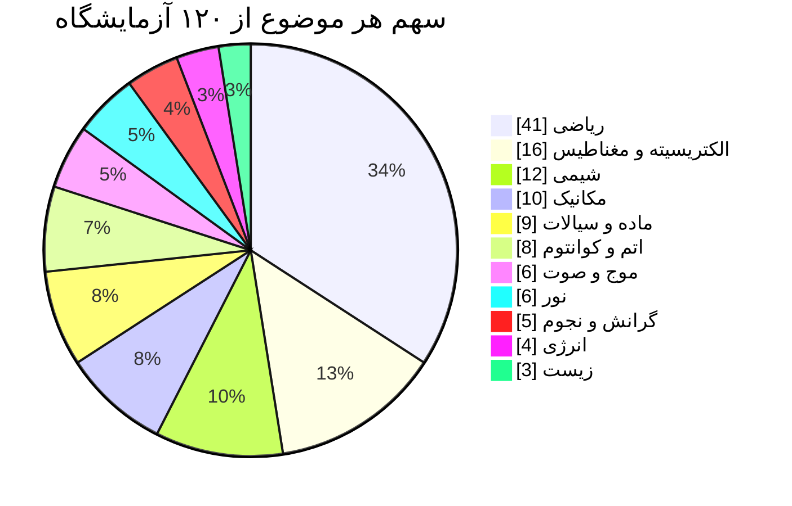

### مقایسهٔ تعداد آزمایش در هر موضوع

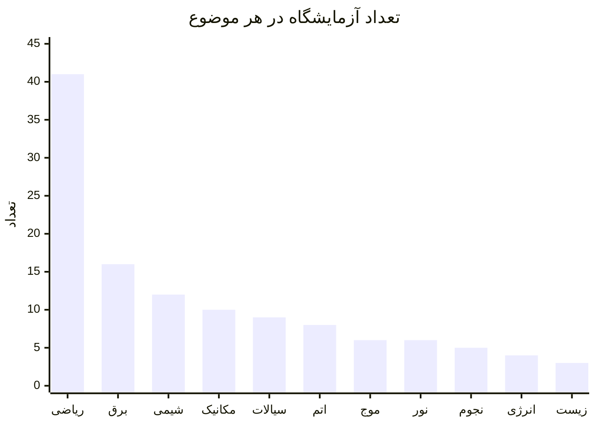

### هستهٔ فیزیک در برابر موضوع‌های مکمل

هشت دستهٔ «فیزیکی» (مکانیک، نجوم، برق، موج، نور، اتم، سیالات، انرژی) روی هم **۶۴** آزمایش‌اند و سه دستهٔ مکمل (ریاضی، شیمی، زیست) **۵۶** آزمایش.

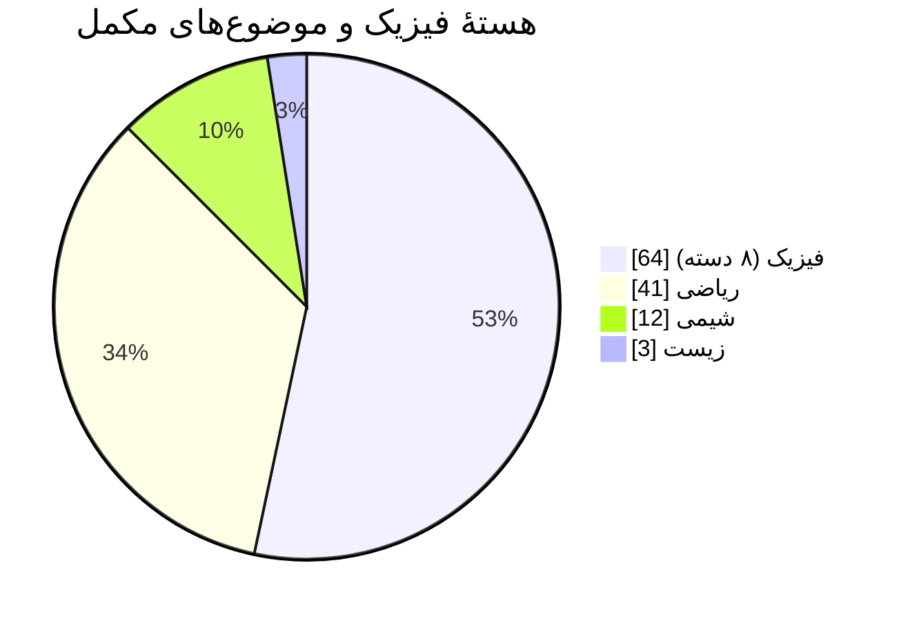

### سطح آزمایش‌ها

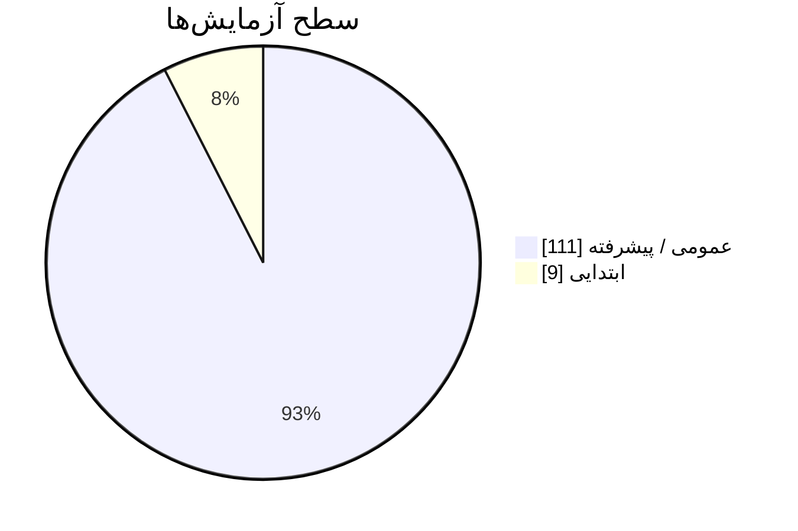

### نقشهٔ ذهنی پورتال

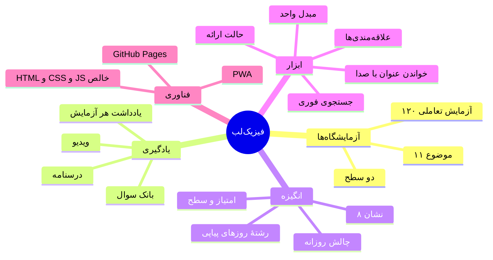

---

## ✨ امکانات سایت

### ۱. صفحهٔ اصلی و کارت آزمایش‌ها

صفحهٔ اصلی شامل این بخش‌هاست:

- **نوار بالای چسبان** با لوگو، دکمهٔ تنظیمات، دکمهٔ تم و دکمهٔ آزمایش تصادفی. هنگام اسکرول، سایه و پس‌زمینهٔ شیشه‌ای می‌گیرد.
- **بخش قهرمان (Hero)** با عنوان گرادیانی متحرک و عددهای شمارندهٔ تعداد آزمایش، تعداد موضوع و تعداد علاقه‌مندی‌ها.
- **کارت ویژه** برای آزمایشگاه الکتریسیته ساکن (باز می‌شود با شناسهٔ `static`) با تصویر متحرک بادکنک و بارها.
- **سه دکمهٔ مرکز یادگیری**: درسنامه، بانک سوالات و ویدیوها.
- **نوار متحرک (Marquee)** از نام همهٔ آزمایش‌ها که با کلیک روی هر مورد، همان آزمایش باز می‌شود.
- **داشبورد پیشرفت**: آواتار، سطح، نوار پیشرفت، رشتهٔ روزها و دکمهٔ چالش امروز.
- **جستجو، فیلتر سطح، دکمهٔ پیشنهاد این ساعت و نوار دسته‌ها**.
- **شبکهٔ کارت‌ها** با انیمیشن ورود پلکانی؛ هر کارت یک شکلک، نام، برچسب موضوع، سطح (در صورت وجود) و دکمهٔ قلب دارد.

> هر کارت هنگام حرکت ماوس کمی کج می‌شود و نوری زیر نشانگر دنبال می‌کند. روی صفحه‌های لمسی و در حالت «کاهش حرکت» این جلوه‌ها غیرفعال یا ساده‌تر می‌شوند.

### ۲. جستجو

- جستجو روی **نام آزمایش** انجام می‌شود و با هر حرفی که تایپ می‌کنید نتیجه را فوراً به‌روز می‌کند.
- حروف عربی «ي» و «ك» پیش از مقایسه به «ی» و «ک» تبدیل می‌شوند؛ پس جستجوی «اسید» نتیجهٔ «اسيد» را هم پیدا می‌کند.
- نویسه‌های لاتین به حروف کوچک تبدیل می‌شوند؛ جستجوی `pH` و `ph` یکسان است.
- کلید **`/`** از هرجای صفحه نشانگر را داخل کادر جستجو می‌برد.
- اگر نتیجه‌ای نباشد، پیام «چیزی پیدا نشد 🔭» نمایش داده می‌شود.

### ۳. دسته‌بندی و فیلتر سطح

| دکمه | کار |
|---|---|
| همه | نمایش تمام آزمایش‌ها |
| ❤️ علاقه‌مندی‌ها | فقط آزمایش‌هایی که قلب زده‌اید |
| ⚙️ مکانیک | آونگ، برخورد، پرتابه، اصطکاک، فنر، گشتاور و… |
| 🪐 گرانش و نجوم | گرانش، قوانین کپلر، منظومهٔ شمسی |
| ⚡ الکتریسیته و مغناطیس | مدار، قانون اهم، کولن، فارادی، آهنربا |
| 🌊 موج و صوت | موج در ریسمان، تداخل، فوریه، صوت |
| 🔦 نور | شکست، نورشناسی هندسی، جسم سیاه |
| ⚛️ اتم و کوانتوم | رادرفورد، مدل‌های اتمی، ایزوتوپ |
| 💧 ماده و سیالات | شناوری، چگالی، گازها، حالت‌های ماده |
| 🔋 انرژی | پیست اسکیت، اثر گلخانه‌ای، تبدیل انرژی |
| 📈 ریاضی | کسر، نسبت، تابع، رگرسیون، مثلثات |
| 🧪 شیمی | pH، مولاریته، شکل مولکول، موازنه |
| 🧬 زیست | نورون، انتخاب طبیعی، بیان ژن |

کنار دسته‌ها یک **فیلتر سطح** هست: «همه سطوح»، «ابتدایی» و «عمومی / پیشرفته». فیلتر سطح با جستجو و دسته هم‌زمان کار می‌کند.

### ۴. علاقه‌مندی‌ها

- روی قلب ♡ بالای هر کارت بزنید تا آزمایش به علاقه‌مندی‌ها اضافه شود (♥).
- شمارندهٔ «مورد علاقه» در بخش آمار فوراً به‌روز می‌شود.
- فهرست علاقه‌مندی‌ها در `localStorage` با کلید `fav` ذخیره می‌شود.
- دکمهٔ «آزمایش تصادفی» اگر علاقه‌مندی داشته باشید، با احتمال حدود ۶۰٪ از میان آن‌ها انتخاب می‌کند و در غیر این صورت از کل فهرست.

### ۵. نمایشگر آزمایش

با کلیک روی یک کارت، آزمایش داخل یک لایهٔ تمام‌صفحه و در یک `iframe` باز می‌شود:

- **نوار بالا** شامل دکمهٔ «بازگشت»، عنوان آزمایش و دکمه‌های ابزار.
- **پیام بارگذاری** تا وقتی فایل آزمایش آماده شود؛ اگر بارگیری بیش از ۶ ثانیه طول بکشد، پیام خودکار پنهان می‌شود تا صفحه مسدود نماند.
- **تذکر چرخاندن گوشی** روی موبایل در حالت عمودی.
- **کلید Esc** (یا دکمهٔ بازگشت) آزمایش را می‌بندد و `iframe` را خالی (`about:blank`) می‌کند تا حافظه و پردازنده آزاد شود.
- **انیمیشن ذرات پس‌زمینه** هنگام باز بودن آزمایش متوقف می‌شود تا کارایی آزمایش کم نشود.
- **دکمهٔ تمام‌صفحه** (⛶) در مرورگرهایی که از آن پشتیبانی نکنند پنهان می‌شود.

### ۶. ابزارهای نوار آزمایش

| دکمه | کار |
|:-:|---|
| 📝 | بازکردن کادر **یادداشت شخصی** برای همین آزمایش؛ متن همان لحظه ذخیره می‌شود |
| 🔗 | **اشتراک‌گذاری** پیوند مستقیم آزمایش (با `navigator.share` یا کپی در کلیپ‌بورد) |
| 🔊 | **خواندن عنوان** آزمایش با صدای مرورگر (`fa-IR`)؛ با فشار دوباره قطع می‌شود |
| 🎞 | **حالت ارائه**: نوار ابزار پنهان می‌شود تا آزمایش روی پروژکتور بزرگ‌تر دیده شود؛ با «خروج از ارائه» یا Esc برمی‌گردید |
| ⛶ | تمام‌صفحه |

### ۷. پیوند مستقیم (Deep Link)

وقتی آزمایشی باز است، نشانی صفحه به شکل `#lab-N` تغییر می‌کند. این نشانی را می‌شود برای دوستان، گروه کلاس یا بله و تلگرام فرستاد تا مستقیم همان آزمایش باز شود.

- `N` همان **شمارهٔ ردیف آزمایش در فهرست، از صفر** است؛ مثلاً `#lab-1` یعنی «آزمایشگاه آونگ».
- برای آزمایشگاه الکتریسیته ساکن از `#lab-static` استفاده کنید.
- بعد از باز شدن صفحه حدود ۲٫۸ ثانیه صبر می‌کند (تا انیمیشن آغاز تمام شود) و بعد آزمایش را باز می‌کند.
- با بستن آزمایش، نشانی دوباره بدون `#` می‌شود.

جدول کامل پیوندها در [فهرست کامل آزمایشگاه‌ها](#-فهرست-کامل-آزمایشگاه‌ها) و [نقشهٔ فایل‌ها](#-پیوست‌ها) آمده است.

### ۸. درسنامه، بانک سوالات و ویدیوها

سه دکمهٔ مرکز یادگیری روی صفحهٔ اصلی:

- **📚 درسنامه — الکتریسیته ساکن**: صفحهٔ آموزشی جداگانه (`121.html`).
- **📝 بانک سوالات — آزمون تعاملی**: همان فایل با نشانی `#bank` که مستقیم روی زبانهٔ آزمون باز می‌شود.
- **🎬 ویدیوها — ۳ ویدیو**: سه پخش‌کنندهٔ اختصاصی (`player111.html`، `player2.html`، `player3.html`) که با `#autoplay` باز می‌شوند. هر ویدیو در پنجرهٔ مخصوص خود باز می‌شود و تمام‌صفحهٔ آن به‌جای تمام‌صفحهٔ خودِ `iframe` انجام می‌شود (روی بعضی گوشی‌های اندروید تمام‌صفحهٔ `iframe` صفحهٔ سیاه می‌داد).

### ۹. مبدل واحد

در پنجرهٔ تنظیمات یک مبدل دوطرفه با هفت تبدیل پرکاربرد هست. هر عددی در یکی از دو کادر بنویسید، دیگری فوراً محاسبه می‌شود (با ۸ رقم معنادار).

| تبدیل | ضریب |
|---|---|
| نیوتن ↔ کیلوگرم‌نیرو | ۱ kgf = ۹٫۸۰۶۶۵ N |
| ژول ↔ کالری | ۱ cal = ۴٫۱۸۴ J |
| m/s ↔ km/h | ضریب ۳٫۶ |
| اتمسفر ↔ پاسکال | ۱ atm = ۱۰۱۳۲۵ Pa |
| الکترون‌ولت ↔ ژول | ۱ eV = ۱٫۶۰۲۱۷۶۶۳۴×۱۰⁻¹⁹ J |
| °C ↔ کلوین | K = °C + ۲۷۳٫۱۵ |
| کیلووات ↔ اسب‌بخار | ۱ kW ≈ ۱٫۳۴۱۰۲ hp |

### ۱۰. تنظیمات و حالت‌های نمایش

- **تم روز و شب**: پیش‌فرض شب است. تغییر تم با یک انتقال دایره‌ای از محل دکمه انجام می‌شود (در مرورگرهای پشتیبان `View Transition`). انتخاب شما در `localStorage` با کلید `th` می‌ماند.
- **پس‌زمینهٔ ذرات**: ذرات باردار مثبت و منفی که از نشانگر فرار می‌کنند، با جرقهٔ برق میان بارهای ناهمنام و دنبالهٔ ستارهٔ دنباله‌دار. از تنظیمات قابل خاموش‌کردن است.
- **حالت مطالعه**: نور گرم و کم برای شب‌خوانی.
- **نصب برنامه**: اگر مرورگر اجازهٔ نصب بدهد، دکمهٔ «📲 نصب برنامه» ظاهر می‌شود.

### ۱۱. جلوه‌ها و جزئیات تعاملی

- نوار پیشرفت اسکرول در بالای صفحه.
- موج دکمه (Ripple) هنگام کلیک روی هر دکمه.
- دکمه‌های «مغناطیسی» که کمی به سمت نشانگر کشیده می‌شوند.
- جرقه و حلقه هنگام کلیک و هنگام زدن قلب.
- ظاهر شدن تدریجی بخش‌ها هنگام اسکرول (با `IntersectionObserver`).
- آشکار شدن دایره‌ای نمایشگر آزمایش از محل کلیک.
- **پیش‌بارگذاری هوشمند**: به‌محض اینکه نشانگر روی یک کارت برود یا انگشت آن را لمس کند، فایل همان آزمایش در پس‌زمینه گرفته می‌شود؛ تا کاربر کلیک کند، معمولاً فایل آماده است.
- **نمایشگر سبک**: وقتی آزمایش باز است، صفحهٔ پشت آن (`content-visibility:hidden`) و انیمیشن‌های Canvas خاموش می‌شوند تا همهٔ توان دستگاه صرف آزمایش شود.
- **زبانهٔ لغزندهٔ مرکز یادگیری**: نشانگر انتخاب بین «درسنامه / بانک سوال / ویدیو» نرم می‌لغزد؛ نوار دسته‌ها هنگام انتخاب جای اسکرول خود را از دست نمی‌دهد.
- **نمایش نتیجهٔ آزمون** با شمارش تدریجی نمره و کاغذ‌رنگی (Confetti)، مگر اینکه کاربر «کاهش حرکت» را فعال کرده باشد.
- **اندازهٔ خودکار پنجرهٔ ویدیو**: پخش‌کننده اندازهٔ خودش را با `postMessage` (نوع `player-size`) اعلام می‌کند و پنجره بر همان اساس تنظیم می‌شود.

---

## 🏅 سیستم امتیاز، سطح و نشان

فیزیک‌لب یک لایهٔ بازی‌وار (Gamification) سبک دارد تا دانش‌آموزان انگیزهٔ بیشتری برای باز کردن آزمایش‌های مختلف پیدا کنند. همهٔ این منطق در مرورگر کاربر اجرا می‌شود و دادهٔ آن در `localStorage` با کلید `pl2` می‌ماند.

### امتیازها (XP)

| رویداد | امتیاز | یادداشت |
|---|:-:|---|
| باز کردن یک آزمایش **برای اولین بار** | ۱۰ | برای هر آزمایش فقط یک بار حساب می‌شود |
| انجام **چالش روزانه** | ۲۰ | روزی یک بار |
| گرفتن هر **نشان** | ۱۵ | به‌محض رسیدن به شرط نشان |
| پیدا کردن **راز پنهان** | ۵۰ | یک بار برای همیشه |
| **رشتهٔ روزهای پیاپی** | ۵ × min(روز، ۷) | از روز دوم به بعد، هنگام اولین ورود هر روز |

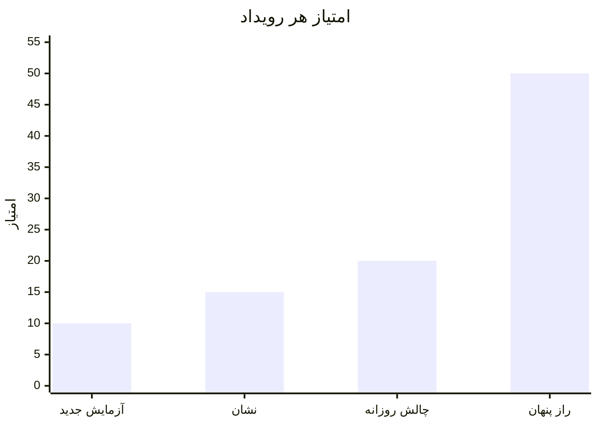

### پاداش رشتهٔ روزها

اگر هر روز دست‌کم یک بار وارد سایت شوید، پاداش ورود روزانه بیشتر می‌شود تا به سقف ۳۵ امتیاز برسد.

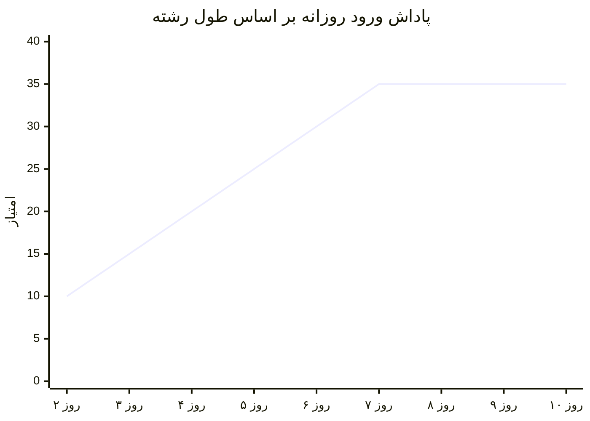

> رشته وقتی قطع می‌شود که یک روز کامل ورود نداشته باشید؛ در این صورت از روز بعدی دوباره از ۱ شروع می‌شود. تقویم بر پایهٔ **زمان جهانی (UTC)** است؛ یعنی مرز روز در ایران حدود ساعت ۳:۳۰ بامداد است.

### سطح و آواتار

هر **۱۰۰ امتیاز** یک سطح است: `سطح = ⌊امتیاز ÷ ۱۰۰⌋ + ۱`. آواتار کنار نام با بالا رفتن سطح عوض می‌شود.

| سطح | آواتار | امتیاز لازم |
|:-:|:-:|:-:|
| ۱ | ⚛️ | ۰ |
| ۲ | 🔬 | ۱۰۰ |
| ۳ | 🧲 | ۲۰۰ |
| ۴ | 🚀 | ۳۰۰ |
| ۵ | 🌌 | ۴۰۰ |
| ۶ و بالاتر | 🕳️ | ۵۰۰ به بعد |

فقط با باز کردن همهٔ ۱۲۰ آزمایش می‌شود ۱۲۰۰ امتیاز گرفت؛ یعنی رسیدن به سطح ۱۳.

### نشان‌ها

| نشان | عنوان | شرط |
|:-:|---|---|
| 👣 | اولین قدم | باز کردن اولین آزمایش |
| 🧭 | کاوشگر | باز کردن ۵ آزمایش |
| 🔭 | دانشمند | باز کردن ۱۵ آزمایش |
| ⚛️ | کوانتومی | ۳ آزمایش از دستهٔ اتم و کوانتوم |
| ⚙️ | مکانیک‌دان | ۳ آزمایش از دستهٔ مکانیک |
| ⚡ | برقکار | ۳ آزمایش از دستهٔ الکتریسیته و مغناطیس |
| 🔥 | ۳ روز پیاپی | رشتهٔ ورود روزانه به ۳ برسد |
| 🥚 | کشف راز | یک راز پنهان در صفحه است |

نشان‌های قفل‌شده در پنجرهٔ تنظیمات کم‌رنگ دیده می‌شوند و بعد از گرفتن پررنگ می‌شوند. هنگام گرفتن نشان، یک پیام کوتاه (Toast) نمایش داده می‌شود.

<details>
<summary>🥚 راز پنهان (اسپویلر)</summary>

سه بار پشت سر هم و سریع (در کمتر از ۱٫۲ ثانیه بین هر کلیک) روی **لوگوی نوار بالا** بزنید.

</details>

### چالش روزانه و پیشنهاد این ساعت

- **چالش روزانه** هر روز یک آزمایش را انتخاب می‌کند. انتخاب فقط به شمارهٔ روز بستگی دارد، پس برای همهٔ کاربران در همان روز یکسان است و می‌شود در کلاس گفت «امروز چالش را همه با هم انجام دهیم». فرمول انتخاب: `D[(روزِ یونیکس × ۷) mod تعداد آزمایش‌ها]`.
- **پیشنهاد این ساعت** بر اساس ساعت دستگاه کار می‌کند: قبل از ظهر آزمایش‌های **ابتدایی** و سبک پیشنهاد می‌شود و بعد از ظهر آزمایش‌های **مفهومی و عمومی**. پس از پیام کوتاه، آزمایش خودکار باز می‌شود.

### مسیر یک دانش‌آموز نمونه

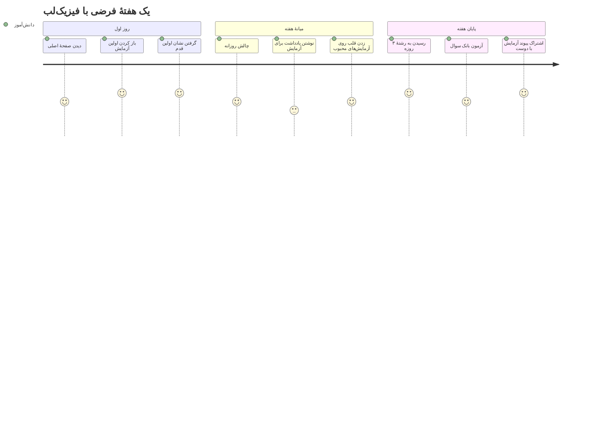

## 🧪 فهرست کامل آزمایشگاه‌ها

در این بخش همهٔ ۱۲۰ آزمایش، به‌همراه نام فایل و پیوند مستقیم، فهرست شده‌اند. جدول‌ها **خودکار از روی آرایهٔ `D` در `index.html`** ساخته شده‌اند.

### چطور جدول‌ها را بخوانیم

| ستون | معنی |
|---|---|
| **شناسه** | شمارهٔ ردیف آزمایش در آرایه، **از صفر**؛ همان `N` در `#lab-N` |
| **فایل** | نام فایلی که سایت بارگیری می‌کند؛ برابر شناسه + ۱ با دو رقم |
| **سطح** | «ابتدایی» یا «—» (یعنی عمومی / پیشرفته) |
| **پیوند** | نشانی مستقیم بعد از انتشار؛ `USERNAME` و `REPO` را با نام خودتان جایگزین کنید |

### آزمایش‌ها و صفحه‌های ویژه

| صفحه | فایل | شناسهٔ پیوند | کار |
|---|---|---|---|
| 🎈 آزمایشگاه الکتریسیته ساکن (ویژه) | `static.html` | `#lab-static` | کارت بزرگ صفحهٔ اصلی |
| 📚 درسنامهٔ الکتریسیته ساکن | `121.html` | — | دکمهٔ «درسنامه» |
| 📝 بانک سوالات | `121.html#bank` | — | دکمهٔ «بانک سوالات» |
| 🎬 ویدیوی آموزشی ۱ | `player111.html#autoplay` | — | دکمهٔ «ویدیوها» |
| 🎬 ویدیوی آموزشی ۲ | `player2.html#autoplay` | — | دکمهٔ «ویدیوها» |
| 🎬 ویدیوی آموزشی ۳ | `player3.html#autoplay` | — | دکمهٔ «ویدیوها» |

### توزیع آزمایش‌ها (نمودار متنی)

| موضوع | تعداد | سهم | نمودار |
|---|:-:|:-:|---|
| 📈 ریاضی | ۴۱ | ۳۴٪ | █████████████████████████████████████████ |
| ⚡ الکتریسیته و مغناطیس | ۱۶ | ۱۳٪ | ████████████████ |
| 🧪 شیمی | ۱۲ | ۱۰٪ | ████████████ |
| ⚙️ مکانیک | ۱۰ | ۸٪ | ██████████ |
| 💧 ماده و سیالات | ۹ | ۸٪ | █████████ |
| ⚛️ اتم و کوانتوم | ۸ | ۷٪ | ████████ |
| 🌊 موج و صوت | ۶ | ۵٪ | ██████ |
| 🔦 نور | ۶ | ۵٪ | ██████ |
| 🪐 گرانش و نجوم | ۵ | ۴٪ | █████ |
| 🔋 انرژی | ۴ | ۳٪ | ████ |
| 🧬 زیست | ۳ | ۲٪ | ███ |

### ماتریس موضوع × سطح

| موضوع | ابتدایی | عمومی / پیشرفته | جمع |
|---|:-:|:-:|:-:|
| ⚙️ مکانیک | ۲ | ۸ | ۱۰ |
| 🪐 گرانش و نجوم | ۱ | ۴ | ۵ |
| ⚡ الکتریسیته و مغناطیس | ۱ | ۱۵ | ۱۶ |
| 🌊 موج و صوت | ۱ | ۵ | ۶ |
| 🔦 نور | ۱ | ۵ | ۶ |
| ⚛️ اتم و کوانتوم | ۰ | ۸ | ۸ |
| 💧 ماده و سیالات | ۲ | ۷ | ۹ |
| 🔋 انرژی | ۱ | ۳ | ۴ |
| 📈 ریاضی | ۰ | ۴۱ | ۴۱ |
| 🧪 شیمی | ۰ | ۱۲ | ۱۲ |
| 🧬 زیست | ۰ | ۳ | ۳ |
| **جمع** | **۹** | **۱۱۱** | **۱۲۰** |

### ⚙️ مکانیک (۱۰ آزمایش)

حرکت، نیرو، تکانه و انرژی مکانیکی؛ پایهٔ بیشتر درس‌های فیزیک دبیرستان.

| شناسه | فایل | | نام آزمایش | سطح | پیوند |
|:-:|:-:|:-:|---|:-:|---|
| 1 | `02.html` | ⚙️ | آزمایشگاه آونگ | — | [`#lab-1`](https://USERNAME.github.io/REPO/#lab-1) |
| 2 | `03.html` | ⚙️ | آزمایشگاه برخورد | — | [`#lab-2`](https://USERNAME.github.io/REPO/#lab-2) |
| 3 | `04.html` | ⚙️ | آزمایشگاه تحلیل پرتابه‌ها | — | [`#lab-3`](https://USERNAME.github.io/REPO/#lab-3) |
| 6 | `07.html` | ⚙️ | آشنایی با نیرو و حرکت؛ اصول اولیه | ابتدایی | [`#lab-6`](https://USERNAME.github.io/REPO/#lab-6) |
| 10 | `11.html` | ⚙️ | اصطکاک | — | [`#lab-10`](https://USERNAME.github.io/REPO/#lab-10) |
| 22 | `23.html` | ⚙️ | جرم ها و فنر ها - مقدمات | ابتدایی | [`#lab-22`](https://USERNAME.github.io/REPO/#lab-22) |
| 26 | `27.html` | ⚙️ | حرکت پرتابه | — | [`#lab-26`](https://USERNAME.github.io/REPO/#lab-26) |
| 36 | `37.html` | ⚙️ | قانون هوک | — | [`#lab-36`](https://USERNAME.github.io/REPO/#lab-36) |
| 38 | `39.html` | ⚙️ | قانون گشتاورها | — | [`#lab-38`](https://USERNAME.github.io/REPO/#lab-38) |
| 67 | `68.html` | ⚙️ | جرم ها و فنرها | — | [`#lab-67`](https://USERNAME.github.io/REPO/#lab-67) |

### 🪐 گرانش و نجوم (۵ آزمایش)

گرانش، مدار سیاره‌ها و قوانین کپلر؛ مناسب برای درک نجوم مقدماتی.

| شناسه | فایل | | نام آزمایش | سطح | پیوند |
|:-:|:-:|:-:|---|:-:|---|
| 4 | `05.html` | 🪐 | آزمایشگاه نیروی گرانش | — | [`#lab-4`](https://USERNAME.github.io/REPO/#lab-4) |
| 5 | `06.html` | 🪐 | آزمایشگاه نیروی گرانش - مقدمات | ابتدایی | [`#lab-5`](https://USERNAME.github.io/REPO/#lab-5) |
| 39 | `40.html` | 🪐 | قوانین کپلر | — | [`#lab-39`](https://USERNAME.github.io/REPO/#lab-39) |
| 42 | `43.html` | 🪐 | منظومه شمسی من | — | [`#lab-42`](https://USERNAME.github.io/REPO/#lab-42) |
| 54 | `55.html` | 🪐 | گرانش و مدار | — | [`#lab-54`](https://USERNAME.github.io/REPO/#lab-54) |

### ⚡ الکتریسیته و مغناطیس (۱۶ آزمایش)

بار الکتریکی، میدان، مدار، مغناطیس و القا؛ بزرگ‌ترین دستهٔ فیزیکی سایت.

| شناسه | فایل | | نام آزمایش | سطح | پیوند |
|:-:|:-:|:-:|---|:-:|---|
| 0 | `01.html` | ⚡ | آزمایش القای الکترومغناطیسی فارادی | — | [`#lab-0`](https://USERNAME.github.io/REPO/#lab-0) |
| 7 | `08.html` | ⚡ | آهنربا و آهنربای الکتریکی | — | [`#lab-7`](https://USERNAME.github.io/REPO/#lab-7) |
| 8 | `09.html` | ⚡ | آهنربا و قطب نما | — | [`#lab-8`](https://USERNAME.github.io/REPO/#lab-8) |
| 15 | `16.html` | ⚡ | بادکنک و الکتریسته ی ساکن | — | [`#lab-15`](https://USERNAME.github.io/REPO/#lab-15) |
| 16 | `17.html` | ⚡ | بارها و میدان ها | — | [`#lab-16`](https://USERNAME.github.io/REPO/#lab-16) |
| 34 | `35.html` | ⚡ | قانون اهم | — | [`#lab-34`](https://USERNAME.github.io/REPO/#lab-34) |
| 35 | `36.html` | ⚡ | قانون فارادی | — | [`#lab-35`](https://USERNAME.github.io/REPO/#lab-35) |
| 37 | `38.html` | ⚡ | قانون کولن | — | [`#lab-37`](https://USERNAME.github.io/REPO/#lab-37) |
| 41 | `42.html` | ⚡ | مقاومت یک سیم | — | [`#lab-41`](https://USERNAME.github.io/REPO/#lab-41) |
| 44 | `45.html` | ⚡ | مولد | — | [`#lab-44`](https://USERNAME.github.io/REPO/#lab-44) |
| 48 | `49.html` | ⚡ | ولتاژ بالا و الکتریسیته ی ساکن | — | [`#lab-48`](https://USERNAME.github.io/REPO/#lab-48) |
| 114 | `115.html` | ⚡ | کیت ساخت مدار: جریان مستقیم (دی سی) | — | [`#lab-114`](https://USERNAME.github.io/REPO/#lab-114) |
| 115 | `116.html` | ⚡ | آزمایشگاه مجازی مدار جریان مستقیم | — | [`#lab-115`](https://USERNAME.github.io/REPO/#lab-115) |
| 116 | `117.html` | ⚡ | کیت ساخت مدار: متناوب | — | [`#lab-116`](https://USERNAME.github.io/REPO/#lab-116) |
| 117 | `118.html` | ⚡ | آزمایشگاه مجازی ساخت مدار جریان متناوب | — | [`#lab-117`](https://USERNAME.github.io/REPO/#lab-117) |
| 118 | `119.html` | ⚡ | آزمایشگاه مجازی خازن: مقدماتی | ابتدایی | [`#lab-118`](https://USERNAME.github.io/REPO/#lab-118) |

### 🌊 موج و صوت (۶ آزمایش)

موج، تداخل، موج ایستاده، صوت و تحلیل فوریه.

| شناسه | فایل | | نام آزمایش | سطح | پیوند |
|:-:|:-:|:-:|---|:-:|---|
| 11 | `12.html` | 🌊 | امواج (مقدماتی) | ابتدایی | [`#lab-11`](https://USERNAME.github.io/REPO/#lab-11) |
| 12 | `13.html` | 🌊 | امواج صوتی | — | [`#lab-12`](https://USERNAME.github.io/REPO/#lab-12) |
| 20 | `21.html` | 🌊 | تداخل امواج | — | [`#lab-20`](https://USERNAME.github.io/REPO/#lab-20) |
| 33 | `34.html` | 🌊 | فوریه - درست کردن امواج | — | [`#lab-33`](https://USERNAME.github.io/REPO/#lab-33) |
| 43 | `44.html` | 🌊 | موج در ریسمان | — | [`#lab-43`](https://USERNAME.github.io/REPO/#lab-43) |
| 119 | `120.html` | 🌊 | مدهای نرمال | — | [`#lab-119`](https://USERNAME.github.io/REPO/#lab-119) |

### 🔦 نور (۶ آزمایش)

بازتاب، شکست، رنگ، طیف و برهم‌کنش نور با ماده.

| شناسه | فایل | | نام آزمایش | سطح | پیوند |
|:-:|:-:|:-:|---|:-:|---|
| 27 | `28.html` | 🔦 | دید رنگی | — | [`#lab-27`](https://USERNAME.github.io/REPO/#lab-27) |
| 30 | `31.html` | 🔦 | شکست نور | — | [`#lab-30`](https://USERNAME.github.io/REPO/#lab-30) |
| 32 | `33.html` | 🔦 | طیف جسم سیاه | — | [`#lab-32`](https://USERNAME.github.io/REPO/#lab-32) |
| 45 | `46.html` | 🔦 | مولکول ها و نور | — | [`#lab-45`](https://USERNAME.github.io/REPO/#lab-45) |
| 46 | `47.html` | 🔦 | نور هندسی - مطالب پایه | ابتدایی | [`#lab-46`](https://USERNAME.github.io/REPO/#lab-46) |
| 47 | `48.html` | 🔦 | نورشناسی هندسی | — | [`#lab-47`](https://USERNAME.github.io/REPO/#lab-47) |

### ⚛️ اتم و کوانتوم (۸ آزمایش)

ساختار اتم، هسته، ایزوتوپ و مفاهیم شهودی کوانتومی.

| شناسه | فایل | | نام آزمایش | سطح | پیوند |
|:-:|:-:|:-:|---|:-:|---|
| 13 | `14.html` | ⚛️ | اندازه‌گیری کوانتومی | — | [`#lab-13`](https://USERNAME.github.io/REPO/#lab-13) |
| 18 | `19.html` | ⚛️ | برهم کنش های اتمی | — | [`#lab-18`](https://USERNAME.github.io/REPO/#lab-18) |
| 40 | `41.html` | ⚛️ | مدل های اتمی برای اتم هیدروژن | — | [`#lab-40`](https://USERNAME.github.io/REPO/#lab-40) |
| 52 | `53.html` | ⚛️ | پراکندگی رادرفورد | — | [`#lab-52`](https://USERNAME.github.io/REPO/#lab-52) |
| 53 | `54.html` | ⚛️ | پرتاب سکه کوانتومی | — | [`#lab-53`](https://USERNAME.github.io/REPO/#lab-53) |
| 55 | `56.html` | ⚛️ | یک اتم بسازید | — | [`#lab-55`](https://USERNAME.github.io/REPO/#lab-55) |
| 56 | `57.html` | ⚛️ | یک هستۀ اتم بساز | — | [`#lab-56`](https://USERNAME.github.io/REPO/#lab-56) |
| 60 | `61.html` | ⚛️ | ایزوتوپ ها و جرم اتمی | — | [`#lab-60`](https://USERNAME.github.io/REPO/#lab-60) |

### 💧 ماده و سیالات (۹ آزمایش)

چگالی، شناوری، فشار، گازها و حالت‌های ماده.

| شناسه | فایل | | نام آزمایش | سطح | پیوند |
|:-:|:-:|:-:|---|:-:|---|
| 19 | `20.html` | 💧 | تحت فشار | — | [`#lab-19`](https://USERNAME.github.io/REPO/#lab-19) |
| 24 | `25.html` | 💧 | حالت های ماده | — | [`#lab-24`](https://USERNAME.github.io/REPO/#lab-24) |
| 25 | `26.html` | 💧 | حالت های ماده - مقدماتی | ابتدایی | [`#lab-25`](https://USERNAME.github.io/REPO/#lab-25) |
| 28 | `29.html` | 💧 | شناوری | — | [`#lab-28`](https://USERNAME.github.io/REPO/#lab-28) |
| 29 | `30.html` | 💧 | شناوری - مفاهیم پایه | ابتدایی | [`#lab-29`](https://USERNAME.github.io/REPO/#lab-29) |
| 49 | `50.html` | 💧 | ویژگی‌های گاز | — | [`#lab-49`](https://USERNAME.github.io/REPO/#lab-49) |
| 51 | `52.html` | 💧 | پخش | — | [`#lab-51`](https://USERNAME.github.io/REPO/#lab-51) |
| 92 | `93.html` | 💧 | مقدمه‌ای بر گازها | — | [`#lab-92`](https://USERNAME.github.io/REPO/#lab-92) |
| 105 | `106.html` | 💧 | چگالی | — | [`#lab-105`](https://USERNAME.github.io/REPO/#lab-105) |

### 🔋 انرژی (۴ آزمایش)

پایستگی و تبدیل انرژی و اثر گلخانه‌ای.

| شناسه | فایل | | نام آزمایش | سطح | پیوند |
|:-:|:-:|:-:|---|:-:|---|
| 14 | `15.html` | 🔋 | انرژی در پیست اسکیت - مقدماتی | ابتدایی | [`#lab-14`](https://USERNAME.github.io/REPO/#lab-14) |
| 31 | `32.html` | 🔋 | شکل ها و تبدیل های انرژی | — | [`#lab-31`](https://USERNAME.github.io/REPO/#lab-31) |
| 50 | `51.html` | 🔋 | پارک اسکیت انرژی | — | [`#lab-50`](https://USERNAME.github.io/REPO/#lab-50) |
| 58 | `59.html` | 🔋 | اثر گلخانه ای | — | [`#lab-58`](https://USERNAME.github.io/REPO/#lab-58) |

### 📈 ریاضی (۴۱ آزمایش)

ابزارهای ریاضی پشتیبان: کسر، نسبت، تابع، بردار، آمار و برازش.

| شناسه | فایل | | نام آزمایش | سطح | پیوند |
|:-:|:-:|:-:|---|:-:|---|
| 9 | `10.html` | 📈 | احتمال پلینکو | — | [`#lab-9`](https://USERNAME.github.io/REPO/#lab-9) |
| 17 | `18.html` | 📈 | برازش منحنی | — | [`#lab-17`](https://USERNAME.github.io/REPO/#lab-17) |
| 21 | `22.html` | 📈 | ترسیم‌گر حساب دیفرانسیل و انتگرال | — | [`#lab-21`](https://USERNAME.github.io/REPO/#lab-21) |
| 23 | `24.html` | 📈 | جمع برداری | — | [`#lab-23`](https://USERNAME.github.io/REPO/#lab-23) |
| 61 | `62.html` | 📐 | بازی با اعداد | — | [`#lab-61`](https://USERNAME.github.io/REPO/#lab-61) |
| 62 | `63.html` | 📐 | بازی با کسرها | — | [`#lab-62`](https://USERNAME.github.io/REPO/#lab-62) |
| 64 | `65.html` | 📐 | توزیع‌ آماری پرتابه‌ها | — | [`#lab-64`](https://USERNAME.github.io/REPO/#lab-64) |
| 65 | `66.html` | 📐 | جابجایی عبارت ریاضی | — | [`#lab-65`](https://USERNAME.github.io/REPO/#lab-65) |
| 66 | `67.html` | 📐 | جبر با مدل مساحت | — | [`#lab-66`](https://USERNAME.github.io/REPO/#lab-66) |
| 68 | `69.html` | 📐 | جفت‌اعداد | — | [`#lab-68`](https://USERNAME.github.io/REPO/#lab-68) |
| 69 | `70.html` | 📐 | جمع بردار - معادلات | — | [`#lab-69`](https://USERNAME.github.io/REPO/#lab-69) |
| 70 | `71.html` | 📐 | رسم خطوط | — | [`#lab-70`](https://USERNAME.github.io/REPO/#lab-70) |
| 71 | `72.html` | 📐 | رسم معادلات درجه دو | — | [`#lab-71`](https://USERNAME.github.io/REPO/#lab-71) |
| 72 | `73.html` | 📐 | رگرسیون (برازش) کمترین مربعات | — | [`#lab-72`](https://USERNAME.github.io/REPO/#lab-72) |
| 73 | `74.html` | 📐 | زمین بازی نسبت | — | [`#lab-73`](https://USERNAME.github.io/REPO/#lab-73) |
| 74 | `75.html` | 📐 | سازندۀ تابع - مقدمات | — | [`#lab-74`](https://USERNAME.github.io/REPO/#lab-74) |
| 75 | `76.html` | 📐 | سازندۀ تابع | — | [`#lab-75`](https://USERNAME.github.io/REPO/#lab-75) |
| 76 | `77.html` | 📐 | سازندۀ مساحت | — | [`#lab-76`](https://USERNAME.github.io/REPO/#lab-76) |
| 77 | `78.html` | 📐 | سفر به دنیای مثلثات | — | [`#lab-77`](https://USERNAME.github.io/REPO/#lab-77) |
| 80 | `81.html` | 📐 | ضرب مدل مساحت | — | [`#lab-80`](https://USERNAME.github.io/REPO/#lab-80) |
| 81 | `82.html` | 📐 | علم حساب | — | [`#lab-81`](https://USERNAME.github.io/REPO/#lab-81) |
| 85 | `86.html` | 📐 | محور اعداد - اعداد صحیح | — | [`#lab-85`](https://USERNAME.github.io/REPO/#lab-85) |
| 86 | `87.html` | 📐 | محور اعداد - عملیات | — | [`#lab-86`](https://USERNAME.github.io/REPO/#lab-86) |
| 87 | `88.html` | 📐 | محور اعداد - فاصله | — | [`#lab-87`](https://USERNAME.github.io/REPO/#lab-87) |
| 88 | `89.html` | 📐 | مدل مساحت اعشاری | — | [`#lab-88`](https://USERNAME.github.io/REPO/#lab-88) |
| 89 | `90.html` | 📐 | مرکز و پراکندگی | — | [`#lab-89`](https://USERNAME.github.io/REPO/#lab-89) |
| 90 | `91.html` | 📐 | معرفی مدل مساحت | — | [`#lab-90`](https://USERNAME.github.io/REPO/#lab-90) |
| 91 | `92.html` | 📐 | مقایسه اعداد | — | [`#lab-91`](https://USERNAME.github.io/REPO/#lab-91) |
| 98 | `99.html` | 📐 | میانگین - تقسیم و متعادل‌سازی | — | [`#lab-98`](https://USERNAME.github.io/REPO/#lab-98) |
| 99 | `100.html` | 📐 | نرخ واحد | — | [`#lab-99`](https://USERNAME.github.io/REPO/#lab-99) |
| 100 | `101.html` | 📐 | نسبت و تناسب | — | [`#lab-100`](https://USERNAME.github.io/REPO/#lab-100) |
| 101 | `102.html` | 📐 | نمودار شیب - تقاطع | — | [`#lab-101`](https://USERNAME.github.io/REPO/#lab-101) |
| 104 | `105.html` | 📐 | چهارضلعی | — | [`#lab-104`](https://USERNAME.github.io/REPO/#lab-104) |
| 106 | `107.html` | 📐 | کاوشگر برابری - دو متغیر | — | [`#lab-106`](https://USERNAME.github.io/REPO/#lab-106) |
| 107 | `108.html` | 📐 | کاوشگر برابری - مقدمات | — | [`#lab-107`](https://USERNAME.github.io/REPO/#lab-107) |
| 108 | `109.html` | 📐 | کاوشگر برابری | — | [`#lab-108`](https://USERNAME.github.io/REPO/#lab-108) |
| 109 | `110.html` | 📐 | کسر بساز | — | [`#lab-109`](https://USERNAME.github.io/REPO/#lab-109) |
| 110 | `111.html` | 📐 | کسرها - اعداد کسری | — | [`#lab-110`](https://USERNAME.github.io/REPO/#lab-110) |
| 111 | `112.html` | 📐 | کسرها - تساوی | — | [`#lab-111`](https://USERNAME.github.io/REPO/#lab-111) |
| 112 | `113.html` | 📐 | کسرها - معرفی | — | [`#lab-112`](https://USERNAME.github.io/REPO/#lab-112) |
| 113 | `114.html` | 📐 | یک ده بساز | — | [`#lab-113`](https://USERNAME.github.io/REPO/#lab-113) |

### 🧪 شیمی (۱۲ آزمایش)

pH، غلظت، مولاریته، موازنه و ساختار مولکول‌ها.

| شناسه | فایل | | نام آزمایش | سطح | پیوند |
|:-:|:-:|:-:|---|:-:|---|
| 57 | `58.html` | 🧪 | آزمایش قانون بیر | — | [`#lab-57`](https://USERNAME.github.io/REPO/#lab-57) |
| 78 | `79.html` | 🧪 | شکل های مولکول - مقدمات | — | [`#lab-78`](https://USERNAME.github.io/REPO/#lab-78) |
| 79 | `80.html` | 🧪 | شکل های مولکول | — | [`#lab-79`](https://USERNAME.github.io/REPO/#lab-79) |
| 82 | `83.html` | 🧪 | غلظت | — | [`#lab-82`](https://USERNAME.github.io/REPO/#lab-82) |
| 83 | `84.html` | 🧪 | قطبيت مولكول | — | [`#lab-83`](https://USERNAME.github.io/REPO/#lab-83) |
| 84 | `85.html` | 🧪 | محلول اسيد - باز | — | [`#lab-84`](https://USERNAME.github.io/REPO/#lab-84) |
| 93 | `94.html` | 🧪 | مقیاس pH - مقدمات | — | [`#lab-93`](https://USERNAME.github.io/REPO/#lab-93) |
| 94 | `95.html` | 🧪 | مقیاس pH | — | [`#lab-94`](https://USERNAME.github.io/REPO/#lab-94) |
| 95 | `96.html` | 🧪 | موازنۀ معادله‌های شیمیایی | — | [`#lab-95`](https://USERNAME.github.io/REPO/#lab-95) |
| 96 | `97.html` | 🧪 | مولاریته | — | [`#lab-96`](https://USERNAME.github.io/REPO/#lab-96) |
| 97 | `98.html` | 🧪 | مولکول بسازید | — | [`#lab-97`](https://USERNAME.github.io/REPO/#lab-97) |
| 103 | `104.html` | 🧪 | واکنش دهنده ها ،محصول ها و پس مانده ها | — | [`#lab-103`](https://USERNAME.github.io/REPO/#lab-103) |

### 🧬 زیست (۳ آزمایش)

نورون، بیان ژن و انتخاب طبیعی.

| شناسه | فایل | | نام آزمایش | سطح | پیوند |
|:-:|:-:|:-:|---|:-:|---|
| 59 | `60.html` | 🧬 | انتخاب طبیعی | — | [`#lab-59`](https://USERNAME.github.io/REPO/#lab-59) |
| 63 | `64.html` | 🧬 | بیان ژن - مبانی | — | [`#lab-63`](https://USERNAME.github.io/REPO/#lab-63) |
| 102 | `103.html` | 🧬 | نورون | — | [`#lab-102`](https://USERNAME.github.io/REPO/#lab-102) |

### آزمایش‌های سطح ابتدایی

اگر کلاس شما تازه شروع کرده یا سن دانش‌آموزان کمتر است، از این ۹ آزمایش شروع کنید. در سایت با فیلتر «ابتدایی» هم دیده می‌شوند.

| شناسه | نام آزمایش | موضوع | پیوند |
|:-:|---|---|---|
| 5 | 🪐 آزمایشگاه نیروی گرانش - مقدمات | 🪐 گرانش و نجوم | [`#lab-5`](https://USERNAME.github.io/REPO/#lab-5) |
| 6 | ⚙️ آشنایی با نیرو و حرکت؛ اصول اولیه | ⚙️ مکانیک | [`#lab-6`](https://USERNAME.github.io/REPO/#lab-6) |
| 11 | 🌊 امواج (مقدماتی) | 🌊 موج و صوت | [`#lab-11`](https://USERNAME.github.io/REPO/#lab-11) |
| 14 | 🔋 انرژی در پیست اسکیت - مقدماتی | 🔋 انرژی | [`#lab-14`](https://USERNAME.github.io/REPO/#lab-14) |
| 22 | ⚙️ جرم ها و فنر ها - مقدمات | ⚙️ مکانیک | [`#lab-22`](https://USERNAME.github.io/REPO/#lab-22) |
| 25 | 💧 حالت های ماده - مقدماتی | 💧 ماده و سیالات | [`#lab-25`](https://USERNAME.github.io/REPO/#lab-25) |
| 29 | 💧 شناوری - مفاهیم پایه | 💧 ماده و سیالات | [`#lab-29`](https://USERNAME.github.io/REPO/#lab-29) |
| 46 | 🔦 نور هندسی - مطالب پایه | 🔦 نور | [`#lab-46`](https://USERNAME.github.io/REPO/#lab-46) |
| 118 | ⚡ آزمایشگاه مجازی خازن: مقدماتی | ⚡ الکتریسیته و مغناطیس | [`#lab-118`](https://USERNAME.github.io/REPO/#lab-118) |

### مسیرهای یادگیری پیشنهادی

این مسیرها فقط پیشنهادند تا ترتیب مفهومی را نشان بدهند؛ هر آزمایش را می‌شود مستقل باز کرد. زمان لازم برای هر آزمایش حدود ۱۰ تا ۲۰ دقیقه برآورد می‌شود.

#### 🧭 مسیر «اولین هفتهٔ فیزیک»

| گام | آزمایش | فایل |
|:-:|---|:-:|
| ۱ | ⚙️ آشنایی با نیرو و حرکت؛ اصول اولیه | `07.html` |
| ۲ | 🔋 انرژی در پیست اسکیت - مقدماتی | `15.html` |
| ۳ | ⚙️ جرم ها و فنر ها - مقدمات | `23.html` |
| ۴ | 🌊 امواج (مقدماتی) | `12.html` |
| ۵ | 🔦 نور هندسی - مطالب پایه | `47.html` |
| ۶ | 💧 شناوری - مفاهیم پایه | `30.html` |
| ۷ | 💧 حالت های ماده - مقدماتی | `26.html` |

⏱️ زمان تقریبی مسیر: **۱۰۵ دقیقه** (۷ آزمایش).

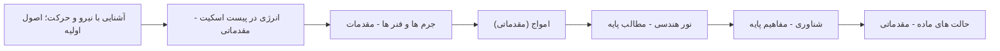

#### ⚡ مسیر «برق از صفر»

| گام | آزمایش | فایل |
|:-:|---|:-:|
| ۱ | ⚡ بادکنک و الکتریسته ی ساکن | `16.html` |
| ۲ | ⚡ قانون کولن | `38.html` |
| ۳ | ⚡ بارها و میدان ها | `17.html` |
| ۴ | ⚡ قانون اهم | `35.html` |
| ۵ | ⚡ مقاومت یک سیم | `42.html` |
| ۶ | ⚡ کیت ساخت مدار: جریان مستقیم (دی سی) | `115.html` |
| ۷ | ⚡ آزمایشگاه مجازی خازن: مقدماتی | `119.html` |
| ۸ | ⚡ آهنربا و آهنربای الکتریکی | `08.html` |
| ۹ | ⚡ قانون فارادی | `36.html` |
| ۱۰ | ⚡ مولد | `45.html` |
| ۱۱ | ⚡ کیت ساخت مدار: متناوب | `117.html` |

⏱️ زمان تقریبی مسیر: **۱۶۵ دقیقه** (۱۱ آزمایش).

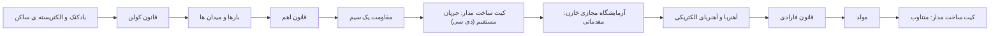

#### ⚙️ مسیر «مکانیک نیوتنی»

| گام | آزمایش | فایل |
|:-:|---|:-:|
| ۱ | ⚙️ آشنایی با نیرو و حرکت؛ اصول اولیه | `07.html` |
| ۲ | ⚙️ اصطکاک | `11.html` |
| ۳ | ⚙️ قانون هوک | `37.html` |
| ۴ | ⚙️ جرم ها و فنرها | `68.html` |
| ۵ | ⚙️ آزمایشگاه آونگ | `02.html` |
| ۶ | ⚙️ حرکت پرتابه | `27.html` |
| ۷ | ⚙️ آزمایشگاه تحلیل پرتابه‌ها | `04.html` |
| ۸ | ⚙️ آزمایشگاه برخورد | `03.html` |
| ۹ | ⚙️ قانون گشتاورها | `39.html` |

⏱️ زمان تقریبی مسیر: **۱۳۵ دقیقه** (۹ آزمایش).

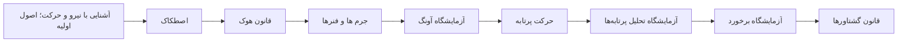

#### 🪐 مسیر «آسمان و گرانش»

| گام | آزمایش | فایل |
|:-:|---|:-:|
| ۱ | 🪐 آزمایشگاه نیروی گرانش - مقدمات | `06.html` |
| ۲ | 🪐 آزمایشگاه نیروی گرانش | `05.html` |
| ۳ | 🪐 گرانش و مدار | `55.html` |
| ۴ | 🪐 قوانین کپلر | `40.html` |
| ۵ | 🪐 منظومه شمسی من | `43.html` |

⏱️ زمان تقریبی مسیر: **۷۵ دقیقه** (۵ آزمایش).

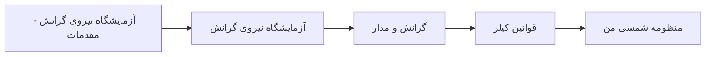

#### 🌊 مسیر «موج و نور»

| گام | آزمایش | فایل |
|:-:|---|:-:|
| ۱ | 🌊 امواج (مقدماتی) | `12.html` |
| ۲ | 🌊 موج در ریسمان | `44.html` |
| ۳ | 🌊 تداخل امواج | `21.html` |
| ۴ | 🌊 مدهای نرمال | `120.html` |
| ۵ | 🌊 فوریه - درست کردن امواج | `34.html` |
| ۶ | 🌊 امواج صوتی | `13.html` |
| ۷ | 🔦 شکست نور | `31.html` |
| ۸ | 🔦 نورشناسی هندسی | `48.html` |
| ۹ | 🔦 طیف جسم سیاه | `33.html` |
| ۱۰ | 🔦 دید رنگی | `28.html` |

⏱️ زمان تقریبی مسیر: **۱۵۰ دقیقه** (۱۰ آزمایش).

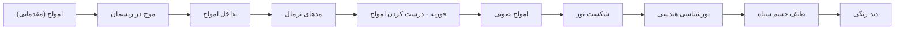

#### ⚛️ مسیر «ساختار ماده»

| گام | آزمایش | فایل |
|:-:|---|:-:|
| ۱ | ⚛️ یک هستۀ اتم بساز | `57.html` |
| ۲ | ⚛️ یک اتم بسازید | `56.html` |
| ۳ | ⚛️ ایزوتوپ ها و جرم اتمی | `61.html` |
| ۴ | ⚛️ پراکندگی رادرفورد | `53.html` |
| ۵ | ⚛️ مدل های اتمی برای اتم هیدروژن | `41.html` |
| ۶ | ⚛️ پرتاب سکه کوانتومی | `54.html` |
| ۷ | ⚛️ اندازه‌گیری کوانتومی | `14.html` |

⏱️ زمان تقریبی مسیر: **۱۰۵ دقیقه** (۷ آزمایش).

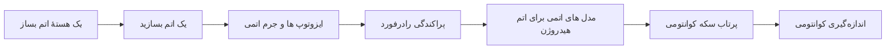

#### 📊 مسیر «تحلیل داده در آزمایش»

| گام | آزمایش | فایل |
|:-:|---|:-:|
| ۱ | 📐 رسم خطوط | `71.html` |
| ۲ | 📐 نمودار شیب - تقاطع | `102.html` |
| ۳ | 📈 برازش منحنی | `18.html` |
| ۴ | 📐 رگرسیون (برازش) کمترین مربعات | `73.html` |
| ۵ | 📐 مرکز و پراکندگی | `90.html` |
| ۶ | 📐 توزیع‌ آماری پرتابه‌ها | `65.html` |

⏱️ زمان تقریبی مسیر: **۹۰ دقیقه** (۶ آزمایش).

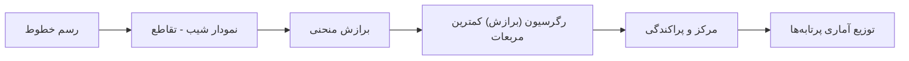

#### 🧪 مسیر «شیمی محلول‌ها»

| گام | آزمایش | فایل |
|:-:|---|:-:|
| ۱ | 🧪 مقیاس pH - مقدمات | `94.html` |
| ۲ | 🧪 مقیاس pH | `95.html` |
| ۳ | 🧪 محلول اسيد - باز | `85.html` |
| ۴ | 🧪 غلظت | `83.html` |
| ۵ | 🧪 مولاریته | `97.html` |
| ۶ | 🧪 آزمایش قانون بیر | `58.html` |

⏱️ زمان تقریبی مسیر: **۹۰ دقیقه** (۶ آزمایش).

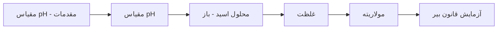


---

## 🏗️ معماری و ساختار پروژه

### نمای کلی

فیزیک‌لب یک سایت **کاملاً استاتیک** است. صفحهٔ `index.html` هم رابط کاربری است و هم فهرست آزمایش‌ها را در خود دارد (آرایهٔ `D`). هر آزمایش یک فایل HTML مستقل است که فقط هنگام نیاز داخل `iframe` بارگیری می‌شود.

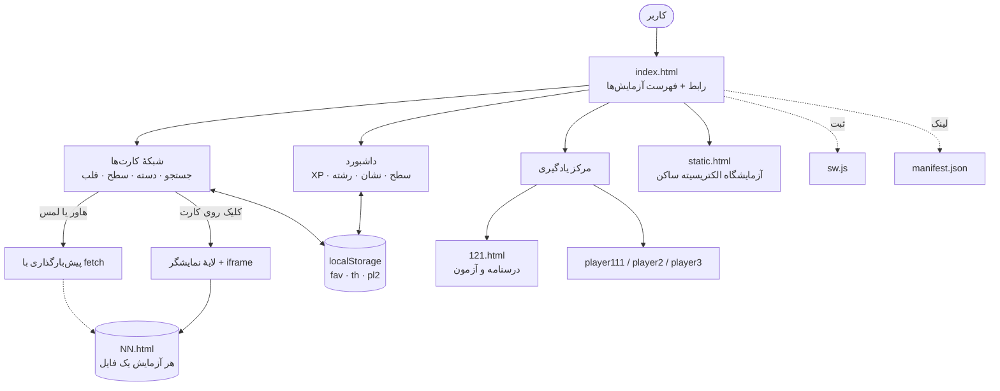

### ساختار فایل‌ها

```text
.
├── index.html          صفحهٔ اصلی: رابط، فهرست آزمایش‌ها، امتیازدهی
├── README.md           همین راهنما
├── manifest.json       مشخصات نصب‌پذیری (PWA)
├── sw.js               سرویس‌ورکر
├── 01.html … 120.html  آزمایشگاه‌ها؛ شمارهٔ فایل = ردیف آزمایش در آرایهٔ D + ۱
├── static.html         آزمایشگاه ویژهٔ الکتریسیته ساکن
├── 121.html            درسنامه و بانک سوال الکتریسیته ساکن
├── player111.html      ویدیوی ۱
├── player2.html        ویدیوی ۲
└── player3.html        ویدیوی ۳
```

> ⚠️ **تفاوت با نسخهٔ قبلی راهنما**: راهنمای قبلی پوشهٔ `labs/` را نام می‌برد، اما کد فعلی `index.html` مسیر فایل‌ها را **نسبی و کنار خودِ صفحه** می‌سازد (`NN.html`). یا فایل‌ها را کنار `index.html` بگذارید، یا اگر می‌خواهید در پوشهٔ `labs/` باشند، در تابع `openLab` پیشوند `labs/` را به مسیر اضافه کنید (راهنمای گام‌به‌گام در [بخش افزودن آزمایش](#-راهنمای-افزودن-آزمایش-ویدیو-و-دسته) است).

### چهار بلوک اسکریپت

`index.html` چهار تکهٔ `<script>` دارد که به ترتیب بارگیری می‌شوند:

| بلوک | کار |
|:-:|---|
| ۱ | `JSON-LD` برای معرفی سایت به موتورهای جستجو |
| ۲ | یک خط کد که صفحهٔ آغازین (Splash) را بعد از ۲٫۷ ثانیه حذف می‌کند |
| ۳ | **هستهٔ برنامه**: داده‌ها (`D`، `C`، `CC`، `lab`)، رندر شبکه، جستجو، تم، انیمیشن ذرات، `openLab` و `closeLab` |
| ۴ | **لایهٔ بازی‌وار و ابزارها**: XP، نشان، رشته، چالش، یادداشت، اشتراک، صدا، حالت ارائه، تنظیمات، مبدل واحد، PWA و پیوند مستقیم |
| ۵ | **مرکز یادگیری**: زبانه‌های درسنامه و آزمون و ویدیو، آرایهٔ `VD` و پنجرهٔ ویدیو |
| ۶ | جلوه‌ها و پرداخت رابط: زبانهٔ لغزنده، نوار دسته‌ها، نوار پیشرفت و نتیجهٔ آزمون، کاغذ‌رنگی |
| ۷ | پیش‌بارگذاری فایل آزمایش هنگام هاور یا لمس کارت |

دو تابع `openLab` و `closeLab` در بلوک ۴ **دوباره پوشش (wrap)** داده می‌شوند تا امتیاز، یادداشت و نشانی را هم مدیریت کنند. اگر خودتان این توابع را تغییر می‌دهید، ترتیب بلوک‌ها را حفظ کنید.

> درسنامه و آزمون هم‌اکنون با باز کردن `121.html` نمایش داده می‌شوند. بخش‌هایی از منطق قدیمی آزمون درون‌صفحه‌ای (مثل مرجع `QZ`) هنوز در بلوک ۵ هست ولی مسیر اصلی از آن عبور نمی‌کند؛ پیش از حذف هر تکه، حتماً آزمون را روی سایت امتحان کنید.

### ساختار هر ردیف آزمایش

```js
// [نام فارسی, کد دسته, شکلک, سطح]
["آزمایشگاه آونگ", "mech", "⚙️", ""]
["مقیاس pH - مقدمات", "chem", "🧪", "ابتدایی"]
```

| فیلد | معنی |
|---|---|
| ۰ | نمایشی و کلید جستجو؛ در `localStorage` هم به‌عنوان شناسهٔ علاقه‌مندی و پیشرفت ذخیره می‌شود |
| ۱ | یکی از کدهای `mech`، `space`، `elec`، `wave`، `light`، `atom`، `fluid`، `energy`، `math`، `chem`، `bio` |
| ۲ | شکلک کارت |
| ۳ | `"ابتدایی"` یا رشتهٔ خالی (عمومی) |

> ⚠️ چون **نام آزمایش** کلید ذخیره‌سازی علاقه‌مندی‌ها و پیشرفت است، تغییر دادن نام یک آزمایش باعث می‌شود قلب و سابقهٔ آن برای کاربران فعلی گم شود. اگر فقط غلط تایپی را درست می‌کنید، بدانید که این اثر را دارد.

### چرخهٔ باز شدن یک آزمایش

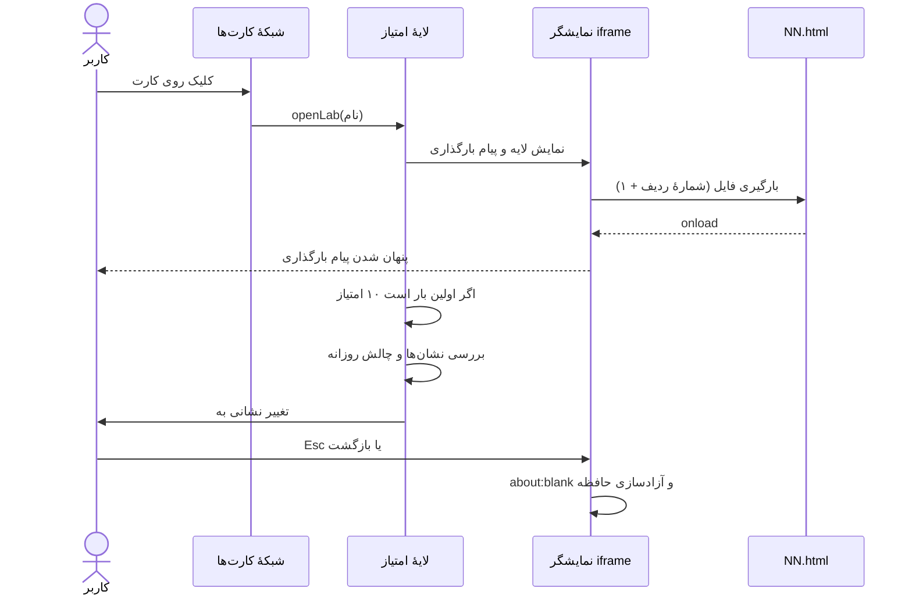

### حالت‌های نمایشگر

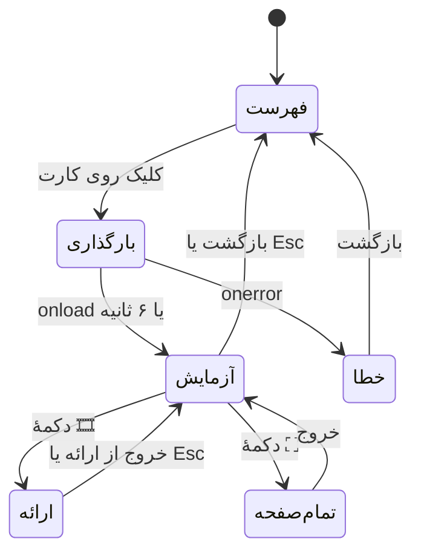

### دادهٔ ذخیره‌شده در مرورگر

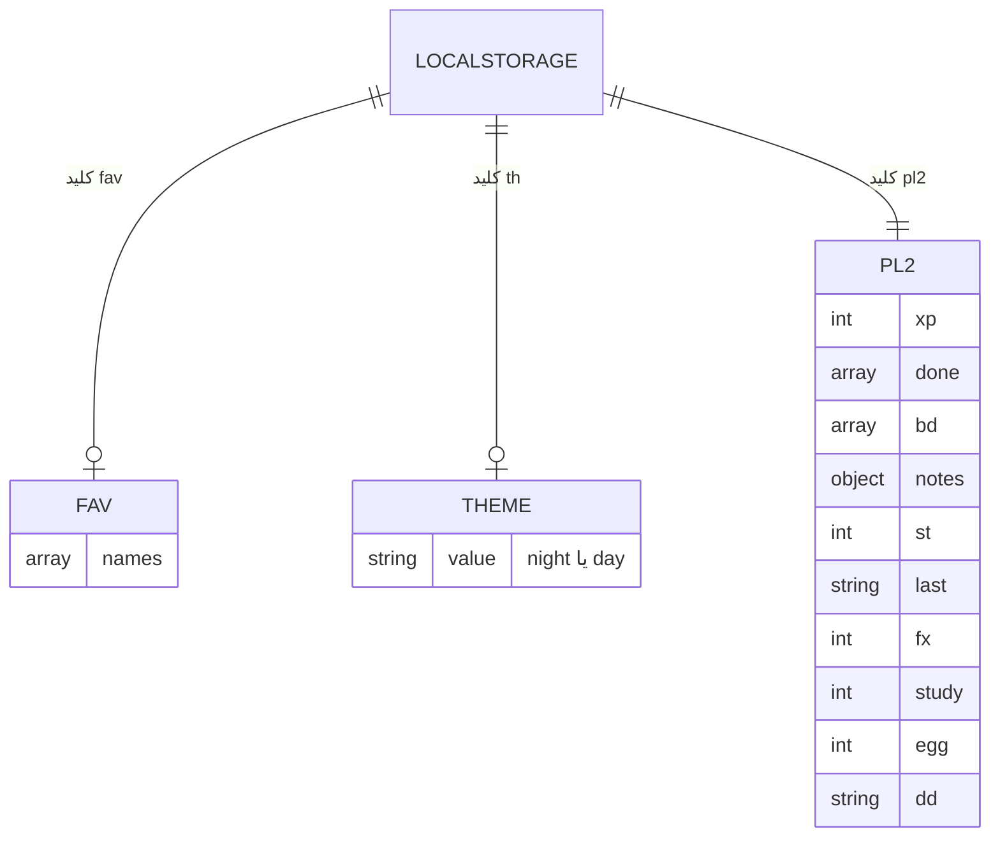

| کلید | محتوا |
|---|---|
| `fav` | آرایهٔ نام آزمایش‌های محبوب |
| `th` | `night` یا `day` |
| `pl2.xp` | مجموع امتیاز |
| `pl2.done` | نام آزمایش‌هایی که باز شده‌اند |
| `pl2.bd` | عنوان نشان‌های گرفته‌شده |
| `pl2.notes` | شیء `نام آزمایش → متن یادداشت` |
| `pl2.st` / `pl2.last` | طول رشتهٔ روزها و تاریخ آخرین ورود (UTC) |
| `pl2.fx` / `pl2.study` | تنظیم ذرات پس‌زمینه / حالت مطالعه |
| `pl2.egg` | آیا راز پنهان پیدا شده |
| `pl2.dd` | تاریخ آخرین چالش انجام‌شده |

همهٔ خواندن‌ها و نوشتن‌ها داخل `try/catch` هستند؛ پس اگر مرورگر ذخیره‌سازی را مسدود کند (مثلاً حالت خصوصی بعضی مرورگرها)، سایت بدون ذخیره‌سازی کار می‌کند و خطا نمی‌دهد.

### داده‌های ساختاریافته و سئو

در سربرگ صفحه یک بلوک `JSON-LD` (نوع `WebSite` با زبان فارسی و نام سازنده به‌عنوان `author`) هست و `<meta name="theme-color">` و تنظیمات وب‌اپ موبایل برای ظاهر بهتر در گوشی‌ها اضافه شده‌اند. همچنین یک **صفحهٔ آغازین** (Splash) حدود ۲٫۷ ثانیه با لوگو و نام سازنده نمایش داده می‌شود.

---

## 🚀 راه‌اندازی و انتشار

### اجرای محلی

سایت استاتیک است، ولی برای آنکه سرویس‌ورکر و بارگیری فایل‌ها درست کار کند بهتر است از طریق یک سرور محلی باز شود، نه با دوبار کلیک روی فایل:

```bash
# در پوشهٔ پروژه
python3 -m http.server 8000
# سپس در مرورگر:
# http://localhost:8000
```

> سرویس‌ورکر فقط وقتی ثبت می‌شود که نشانی با `http` یا `https` شروع شود؛ پس باز کردن مستقیم فایل (`file://`) فقط سایت را بدون قابلیت نصب نشان می‌دهد.

### انتشار روی GitHub Pages

```mermaid
flowchart LR
    A["ساخت مخزن در GitHub"] --> B["آپلود همهٔ فایل‌ها"]
    B --> C[Settings ← Pages]
    C --> D[Source: Deploy from a branch]
    D --> E[Branch: main · پوشهٔ root · Save]
    E --> F{یکی دو دقیقه صبر}
    F --> G["https://USERNAME.github.io/REPO/"]
```

1. وارد **Settings ← Pages** شوید.
2. در بخش **Source** گزینهٔ **Deploy from a branch** را بزنید.
3. شاخهٔ `main` و پوشهٔ `/(root)` را انتخاب و **Save** کنید.
4. بعد از یکی دو دقیقه سایت در `https://USERNAME.github.io/REPO/` باز می‌شود.

### نکته‌های مهم انتشار

- **حروف بزرگ و کوچک** در نام فایل‌ها مهم است. `01.html` با `01.HTML` فرق دارد.
- بعد از هر انتشار، مرورگر ممکن است نسخهٔ قدیمی را از **کش** نشان بدهد. با `Ctrl+Shift+R` تازه‌سازی کامل کنید و اگر `sw.js` فایل‌ها را کش می‌کند، شمارهٔ نسخهٔ کش را هنگام تغییر محتوا عوض کنید.
- مخزن عمومی (Public) برای Pages رایگان لازم است، مگر آنکه حساب شما اجازهٔ مخزن خصوصی را بدهد.
- هر آزمایش را زیر **۶ مگابایت** نگه دارید تا روی اینترنت ضعیف هم سریع باز شود. اگر فایلی بزرگ‌تر شد، تصویرها را فشرده یا داخل `data:` بسیار کوچک کنید.
- محدودیت‌های اندازه و پهنای باند GitHub Pages ممکن است تغییر کند؛ پیش از انتشار حجم زیاد، مستندات رسمی GitHub را ببینید.

### سایر میزبان‌ها

چون هیچ مرحلهٔ ساخت و هیچ سرور لازم نیست، همین پوشه را روی هر میزبان استاتیکی می‌شود گذاشت: Cloudflare Pages، Netlify، Vercel، GitLab Pages یا یک میزبان ساده. تنها قاعده این است که `index.html` در ریشهٔ سایت باشد و فایل‌ها با همان نام‌ها در دسترس باشند. برای دامنهٔ اختصاصی، در GitHub Pages فایل `CNAME` یا تنظیمات Custom domain کافی است.

### نصب روی موبایل (PWA)

- **اندروید (Chrome)**: وقتی مرورگر آمادگی نصب را اعلام کند، در تنظیمات سایت دکمهٔ «📲 نصب برنامه» ظاهر می‌شود؛ یا از منوی مرورگر «Add to Home screen».
- **آیفون (Safari)**: دکمهٔ اشتراک ← **Add to Home Screen**.
- پس از نصب، سایت تمام‌صفحه و بدون نوار آدرس باز می‌شود.

---

## 🧩 راهنمای افزودن آزمایش، ویدیو و دسته

### افزودن یک آزمایش جدید

```mermaid
flowchart TD
    S(["آزمایش جدید"]) --> A["۱) فایل HTML خودکفا بسازید"]
    A --> B["۲) نام فایل: NN.html<br/>NN برابر ردیف جدید در D بعلاوهٔ ۱"]
    B --> C["۳) یک ردیف به انتهای آرایهٔ D اضافه کنید"]
    C --> D["۴) روی سرور محلی امتحان کنید"]
    D --> E{"باز می‌شود؟"}
    E -- خیر --> F["مسیر و نام فایل را بررسی کنید"]
    F --> D
    E -- بله --> G["۵) اندازه زیر ۶ مگابایت؟"]
    G --> H["۶) commit و push"]
    H --> I(["منتشر شد"])
```

۱. **فایل آزمایش** را بسازید. بهتر است خودکفا باشد (CSS و JS داخل خودش) و برای موبایل `<meta name="viewport" content="width=device-width,initial-scale=1">` داشته باشد.

۲. **نام فایل** باید شمارهٔ ردیف جدید باشد. اگر الان ۱۲۰ آزمایش دارید، ردیف جدید می‌شود ۱۲۱ام. اما چون `121.html` برای درسنامهٔ الکتریسیته ساکن **رزرو شده است**، یا آن فایل را جابه‌جا کنید یا ردیف‌های بعدی را با دقت برنامه‌ریزی کنید (به هشدار پایین نگاه کنید).

۳. **ردیف را به انتهای آرایه `D` اضافه کنید**، نه وسط آن:

```js
["آزمایش نمونه", "elec", "⚡", ""],
```

۴. شمارندهٔ «آزمایشگاه» روی صفحه، نوار متحرک، جستجو و همهٔ فهرست‌ها **خودکار** از روی `D` ساخته می‌شوند؛ جای دیگری را لازم نیست دست بزنید.

> ⚠️ **هشدار شماره‌گذاری**: نام فایل هر آزمایش از **جایگاه آن در آرایه** ساخته می‌شود (`pad(index)`). اگر ردیفی را از وسط آرایه حذف یا اضافه کنید، همهٔ آزمایش‌های بعد از آن یک شماره جابه‌جا می‌شوند و به فایل اشتباه وصل می‌شوند. همچنین پیوندهای مستقیم `#lab-N` که قبلاً به اشتراک گذاشته‌اید عوض می‌شوند.
>
> ⚠️ **برخورد با ۱۲۱**: درسنامه با نام `121.html` باز می‌شود. اگر روزی آزمایش شمارهٔ ۱۲۱ را اضافه کنید، با این فایل برخورد می‌کند. راه‌حل ساده: درسنامه را به نامی مثل `lesson-static.html` منتقل کنید و در تابع `openLab` نام فایل را عوض کنید.

### انتقال آزمایش‌ها به پوشهٔ `labs/`

اگر می‌خواهید ریشهٔ مخزن مرتب بماند، فایل‌های `NN.html` را به پوشهٔ `labs/` ببرید و در تابع `openLab` مسیر را این‌طور بسازید:

```js
// قبل
const file = (st ? 'static' : pad(I[n])) + '.html';
// بعد
const file = 'labs/' + (st ? 'static' : pad(I[n])) + '.html';
```

برای فایل‌های درسنامه و ویدیو هم همین پیشوند را در جای مناسب اضافه کنید. پس از جابه‌جایی، یک بار همهٔ آزمایش‌ها را با [فهرست کنترل کیفیت](#-کنترل-کیفیت-و-پاک‌سازی-دادهٔ-آزمایش‌ها) بررسی کنید.

### افزودن ویدیو

آرایهٔ `VD` در بلوک «مرکز یادگیری» (بلوک ۵) را باز کنید و یک شیء اضافه کنید:

```js
{ "t": "ویدیوی آموزشی ۴", "d": "پخش‌کنندهٔ اختصاصی، مناسب موبایل", "u": "player4.html#autoplay" }
```

سپس فایل پخش‌کننده را بسازید. برای ظاهر دکمه «۳ ویدیو» روی صفحهٔ اصلی، متن دکمهٔ مرکز یادگیری (`ویدیوها ۳ ویدیو`) را هم دستی به‌روز کنید.

### افزودن موضوع (دسته) جدید

سه شیء را هم‌زمان تغییر بدهید:

```js
const C  = { /* ... */ phys2: '🧲 موضوع جدید' };   // برچسب دکمهٔ دسته
const CC = { /* ... */ phys2: '#ff7a59' };          // رنگ نشان کارت
const lab = { /* ... */ phys2: 'نام کوتاه' };        // برچسب روی کارت
```

شمارندهٔ «موضوع» از تعداد کلیدهای `lab` ساخته می‌شود، پس خودکار به‌روز می‌شود.

### افزودن نشان جدید

آرایهٔ `B` در بلوک «لایهٔ بازی‌وار» (بلوک ۴) را باز کنید. هر نشان `[شکلک, عنوان, تابع شرط]` است:

```js
['🏆', 'نیمه‌راه (۶۰ آزمایش)', () => S.done.length >= 60]
```

از `S.done` (آزمایش‌های باز شده)، `S.st` (رشتهٔ روزها)، `S.xp` و تابع `cnt('mech')` (تعداد آزمایش‌های انجام‌شده از یک دسته) می‌توان در شرط استفاده کرد.

### افزودن مبدل واحد

آرایهٔ `U` هر مورد را به شکل `[عنوان, تابع جهت اول, تابع جهت دوم]` نگه می‌دارد:

```js
['میلی‌متر ↔ اینچ', v => v / 25.4, v => v * 25.4]
```

### آزمایش خوب چه ویژگی‌هایی دارد؟

- روی صفحهٔ کوچک (حدود ۳۶۰ پیکسل) بدون اسکرول افقی کار کند.
- کنترل‌ها برای لمس به اندازهٔ کافی بزرگ باشند.
- برچسب‌ها فارسی و اعداد خوانا باشند.
- بدون نیاز به اینترنت (به‌جز فونت) اجرا شود.
- در حالت تمام‌صفحه و حالت ارائه خراب نشود.
- پس از بسته‌شدن، زمان‌سنج یا انیمیشن در پس‌زمینه ادامه ندهد.


---

## 🎓 راهنمای معلم: ایدهٔ کلاسی برای آزمایش‌های اصلی

این بخش پیشنهادهایی برای استفادهٔ آموزشی از آزمایش‌هاست. نام آزمایش‌ها همان نام‌های داخل سایت است. زمان‌ها تقریبی‌اند و می‌توانید آن‌ها را با کلاس خودتان تنظیم کنید.

### الگوی کلی یک جلسه (۴۵ دقیقه)

```mermaid
gantt
    title الگوی پیشنهادی یک جلسهٔ ۴۵ دقیقه‌ای
    dateFormat  HH:mm
    axisFormat  %H:%M
    section آماده‌سازی
    طرح پرسش و پیش‌بینی دانش‌آموزان :a1, 00:00, 5m
    section کاوش
    کار آزاد با آزمایش (جفتی) :a2, after a1, 15m
    section گفتگو
    ثبت داده و بحث گروهی :a3, after a2, 10m
    section جمع‌بندی
    ارائهٔ نتیجه با حالت ارائه :a4, after a3, 8m
    پرسش‌های بانک سوال :a5, after a4, 7m
```

قاعدهٔ طلایی: **اول پیش‌بینی، بعد آزمایش**. از دانش‌آموزان بخواهید قبل از لمس آزمایش، روی کاغذ بنویسند چه اتفاقی می‌افتد و چرا. بعد با آزمایش مقایسه کنند.

### مکانیک

#### آزمایشگاه آونگ
- **هدف**: دیدن اینکه دورهٔ آونگ ساده به طول و شتاب گرانش وابسته است و به جرم وابسته نیست (برای زاویه‌های کوچک).
- **پرسش پیش‌بینی**: «اگر جرم را دو برابر کنیم دوره بیشتر می‌شود؟»
- **کار دانش‌آموز**: طول را ۴ مقدار مختلف بگذارد، دوره را بسنجد و جدول بسازد.
- **فرمول مرجع**:

$$T = 2\pi\sqrt{\frac{L}{g}}$$

- **سوال بحث**: چرا در زاویه‌های بزرگ فرمول دقیق نیست؟

#### آزمایشگاه برخورد
- **هدف**: پایستگی تکانه و تفاوت برخورد کشسان و ناکشسان.
- **کار**: جرم‌ها و سرعت‌ها را تغییر دهند و تکانهٔ کل را قبل و بعد مقایسه کنند.

$$m_1v_1 + m_2v_2 = m_1v_1' + m_2v_2'$$

- **سوال بحث**: انرژی جنبشی در برخورد ناکشسان کجا می‌رود؟

#### آزمایشگاه تحلیل پرتابه‌ها و حرکت پرتابه
- **هدف**: تجزیهٔ حرکت به دو مؤلفهٔ مستقل افقی و قائم.
- **کار**: زاویه را از ۱۵° تا ۷۵° تغییر دهند و برد را ثبت کنند. زاویهٔ بیشینهٔ برد را (در شرایط بدون مقاومت هوا) پیدا کنند.

$$R = \frac{v_0^2 \sin 2\theta}{g}$$

- **سوال بحث**: چرا دو زاویهٔ مکمل برد یکسان می‌دهند؟ مقاومت هوا چه تغییری می‌دهد؟

#### قانون هوک، جرم‌ها و فنرها
- **هدف**: رابطهٔ خطی نیروی فنر و کشیدگی و پیدا کردن ثابت فنر از شیب نمودار.

$$F = -kx$$

- **کار**: وزنه‌های مختلف آویزان کنند و نمودار نیرو–کشیدگی بکشند (می‌توانند از «برازش منحنی» هم کمک بگیرند).
- **سوال بحث**: در چه کشیدگی‌هایی قانون هوک دیگر برقرار نیست؟

#### اصطکاک
- **هدف**: تفاوت اصطکاک ایستایی و جنبشی و نقش سطوح مختلف.
- **سوال بحث**: چرا شروع حرکت جسم سنگین سخت‌تر از ادامهٔ آن است؟

#### قانون گشتاورها
- **هدف**: تعادل چرخشی؛ گشتاور برابر است با نیرو ضرب‌در بازو.

$$\tau = r F \sin\theta$$

### گرانش و نجوم

#### آزمایشگاه نیروی گرانش و گرانش و مدار
- **هدف**: وابستگی نیروی گرانش به جرم‌ها و فاصله.

$$F = G\frac{m_1 m_2}{r^2}$$

- **کار**: فاصله را دو برابر کنند و نسبت نیرو را بخوانند. الگو را «قانون عکس مجذور» نام‌گذاری کنند.
- **سوال بحث**: اگر زمین ناگهان جرمش دو برابر شود مدار ماه چه می‌شود؟

#### قوانین کپلر
- **هدف**: سه قانون: مدار بیضی، سرعت سطحی ثابت و رابطهٔ دوره و اندازهٔ مدار.

$$\frac{T^2}{a^3} = \text{ثابت}$$

- **کار**: برای چند سیاره دورهٔ مداری و نیم‌قطر بزرگ را بخوانند و ثابت بودن نسبت را بررسی کنند.

#### منظومهٔ شمسی من
- **هدف**: بازی با جرم ستاره و سیاره‌ها و دیدن پایداری یا فروپاشی مدارها.

### الکتریسیته و مغناطیس

#### قانون اهم، مقاومت یک سیم، کیت ساخت مدار
- **هدف**: رابطهٔ ولتاژ، جریان و مقاومت و اثر طول و سطح مقطع بر مقاومت.

$$V = IR \qquad R = \rho\frac{L}{A}$$

- **کار**: مدار ساده با یک مقاومت بسازند، ولتاژ را تغییر دهند و نمودار جریان–ولتاژ بکشند؛ سپس دو مقاومت را متوالی و موازی ببندند.
- **سوال بحث**: چرا در مدار موازی جریان کل بیشتر از هر شاخه است؟

| اتصال | مقاومت معادل |
|---|---|
| متوالی (سری) | $R_{eq} = R_1 + R_2 + \cdots$ |
| موازی | $\dfrac{1}{R_{eq}} = \dfrac{1}{R_1} + \dfrac{1}{R_2} + \cdots$ |

#### قانون کولن، بارها و میدان‌ها، بادکنک و الکتریسیتهٔ ساکن
- **هدف**: نیروی بین بارها و مفهوم میدان.

$$F = k\frac{|q_1 q_2|}{r^2}$$

- **کار**: علامت و اندازهٔ بارها را تغییر دهند و جهت نیرو و خطوط میدان را رسم کنند.
- **سوال بحث**: چرا بادکنک مالیده‌شده به دیوار می‌چسبد، با اینکه دیوار خنثی است؟ (القای بار)

#### ولتاژ بالا و الکتریسیتهٔ ساکن، آزمایشگاه ویژه (static)
- **هدف**: تخلیهٔ الکتریکی و برق‌نما. می‌شود در کنار درسنامه و بانک سوال استفاده کرد.

#### آهنربا و قطب‌نما، آهنربای الکتریکی
- **هدف**: میدان مغناطیسی آهنربا و سیم‌لوله و اثر تعداد حلقه‌ها و جریان.

#### قانون فارادی و القای الکترومغناطیسی، مولد
- **هدف**: تغییر شار مغناطیسی نیروی محرکهٔ القایی ایجاد می‌کند.

$$\varepsilon = -N\frac{\Delta\Phi}{\Delta t}$$

- **کار**: سرعت حرکت آهنربا را تغییر دهند و دامنهٔ ولتاژ را ببینند.
- **سوال بحث**: علامت منفی در رابطه چه چیزی را می‌گوید؟ (قانون لنز)

### موج و صوت

#### موج در ریسمان، تداخل امواج، مدهای نرمال
- **هدف**: بسامد، طول موج و سرعت، تداخل سازنده و ویرانگر، موج ایستاده.

$$v = f\lambda$$

#### فوریه: درست کردن امواج
- **هدف**: هر موج پیچیده را می‌شود از چند موج سینوسی ساخت.

#### امواج صوتی
- **هدف**: رابطهٔ بسامد با زیری، دامنه با بلندی و سرعت صوت در محیط.

### نور

#### شکست نور و نورشناسی هندسی
- **هدف**: قانون اسنل و آینه و عدسی.

$$n_1\sin\theta_1 = n_2\sin\theta_2$$

- **کار**: زاویهٔ تابش را تغییر دهند، زاویهٔ شکست را بخوانند و ضریب شکست محیط ناشناخته را حدس بزنند.
- **سوال بحث**: چرا شنا کردن در استخر عمق را کمتر از واقعی نشان می‌دهد؟

#### طیف جسم سیاه
- **هدف**: با بالا رفتن دما قلهٔ تابش به طول موج کوتاه‌تر می‌رود و توان بیشتر می‌شود.

$$\lambda_{max}T = b$$

#### دید رنگی و مولکول‌ها و نور
- **هدف**: چگونگی دیدن رنگ، و برهم‌کنش نور مرئی و فروسرخ با مولکول‌ها (پیوند با اثر گلخانه‌ای).

### اتم و کوانتوم

#### پراکندگی رادرفورد
- **هدف**: دیدن اینکه چرا مدل «کیک کشمشی» جای خود را به مدل هستهٔ کوچک و چگال داد.
- **سوال بحث**: اگر بیشتر ذرات آلفا مستقیم عبور می‌کنند، پس بیشتر اتم چیست؟

#### مدل‌های اتمی برای اتم هیدروژن
- **هدف**: مقایسهٔ مدل‌های تامسون، رادرفورد، بور و کوانتومی و دیدن محدودیت هر کدام.

#### یک اتم بسازید، یک هستهٔ اتم بساز، ایزوتوپ‌ها و جرم اتمی
- **هدف**: ارتباط تعداد پروتون، نوترون و الکترون با عنصر، بار و جرم.

#### اندازه‌گیری کوانتومی، پرتاب سکهٔ کوانتومی، برهم‌کنش‌های اتمی
- **هدف**: آشنایی شهودی با احتمال و اندازه‌گیری در مقیاس کوانتومی.
- **نکته**: برای مخاطب مبتدی این‌ها را «بازی احتمال» معرفی کنید و فقط مفهوم «نتیجه تصادفی است ولی الگوی آماری دارد» را تأکید کنید.

### ماده و سیالات

#### شناوری و چگالی

$$F_b = \rho_{\text{سیال}}\, V_{\text{فرو‌رفته}}\, g \qquad \rho = \frac{m}{V}$$

- **کار**: جسم‌هایی با جرم برابر و حجم‌های متفاوت را داخل آب بیندازند؛ پیش‌بینی کنند کدام غرق می‌شود.
- **سوال بحث**: یک کشتی فولادی چرا غرق نمی‌شود؟

#### تحت فشار، ویژگی‌های گاز، مقدمه‌ای بر گازها

$$P V = n R T$$

- **کار**: دما را ثابت نگه دارند، حجم را کم کنند و ببینند فشار چه می‌شود (قانون بویل).

#### حالت‌های ماده
- **هدف**: ارتباط دما و انرژی با جامد، مایع و گاز شدن ماده.

### انرژی

#### انرژی در پیست اسکیت، پارک اسکیت انرژی، شکل‌ها و تبدیل‌های انرژی
- **هدف**: تبدیل انرژی پتانسیل به جنبشی و گرما، و پایستگی انرژی.

$$E = \tfrac{1}{2}mv^2 + mgh$$

- **سوال بحث**: اگر اصطکاک را روشن کنیم انرژی کل چه می‌شود؟ کجا رفت؟

#### اثر گلخانه‌ای
- **هدف**: نقش گازهای گلخانه‌ای در جذب تابش فروسرخ. مناسب برای جلسهٔ میان‌رشته‌ای فیزیک و محیط‌زیست.

### ریاضی، شیمی و زیست (پشتیبان درس‌های فیزیک)

| ابزار | به چه کار فیزیک می‌آید |
|---|---|
| جمع برداری، جمع بردار - معادلات | ترکیب نیروها و سرعت‌ها |
| رسم خطوط، نمودار شیب - تقاطع | خواندن نمودار حرکت و نیرو |
| برازش منحنی، رگرسیون کمترین مربعات | ثابت فنر، شتاب گرانش و هر دادهٔ آزمایشی |
| ترسیم‌گر حساب دیفرانسیل و انتگرال | مفهوم شیب و مساحت زیر نمودار (سرعت و جابه‌جایی) |
| سفر به دنیای مثلثات | تجزیهٔ بردار و پرتابه |
| نسبت و تناسب، نرخ واحد | تبدیل واحد و فرمول‌های تناسبی |
| مرکز و پراکندگی، توزیع آماری پرتابه‌ها | خطای اندازه‌گیری و میانگین |
| pH، مولاریته، غلظت | مقدمهٔ سیالات و محلول‌ها |
| شکل مولکول‌ها، قطبیت مولکول | ارتباط ساختار و نیروهای بین‌مولکولی |
| نورون | سیگنال الکتریکی در سامانهٔ عصبی |

### برگهٔ ثبت داده (قابل چاپ)

| ردیف | متغیر مستقل | متغیر وابسته | مشاهده | شکل نمودار |
|:-:|---|---|---|---|
| ۱ | | | | |
| ۲ | | | | |
| ۳ | | | | |
| ۴ | | | | |
| ۵ | | | | |

**نتیجه‌گیری در یک جمله**: «وقتی ……… افزایش یابد، ……… ………».

### نکات مدیریت کلاس

- از هر جفت بخواهید **فقط یک** متغیر را تغییر دهد و بقیه را ثابت نگه دارد.
- از حالت **ارائه** برای نمایش روی پروژکتور استفاده کنید تا نوار ابزار حواس را پرت نکند.
- از **یادداشت** داخل نمایشگر برای ثبت یک جملهٔ مشاهده استفاده کنید؛ بعد از بستن آزمایش هم باقی می‌ماند.
- **چالش روزانه** را به‌عنوان تکلیف اختیاری بدهید: چون برای همه یکسان است، فردا می‌شود دربارهٔ آن گفتگو کرد.
- پیوند مستقیم آزمایش را (دکمهٔ 🔗) در گروه کلاس بگذارید.

---

## 📖 واژه‌نامهٔ فیزیک

| واژه | تعریف کوتاه |
|---|---|
| آونگ | وزنه‌ای که از نقطه‌ای آویزان است و نوسان می‌کند |
| اصطکاک | نیروی مقاوم بین دو سطح در تماس |
| انرژی پتانسیل | انرژی ذخیره‌شده به‌دلیل وضعیت یا مکان جسم |
| انرژی جنبشی | انرژی ناشی از حرکت جسم |
| بار الکتریکی | ویژگی ماده که باعث نیروی الکتریکی می‌شود؛ مثبت یا منفی |
| بسامد (فرکانس) | تعداد نوسان در یک ثانیه، با یکای هرتز |
| برازش | پیدا کردن منحنی‌ای که بهترین تطابق را با نقطه‌های داده دارد |
| بردار | کمیتی با اندازه و جهت |
| تداخل | ترکیب دو موج که در هم می‌افتند |
| تکانه | حاصل‌ضرب جرم در سرعت |
| جسم سیاه | جسم آرمانی که تمام تابش رسیده را جذب می‌کند |
| چگالی | جرم بر واحد حجم |
| دوره (تناوب) | زمان یک نوسان کامل |
| دامنه | بیشینهٔ جابه‌جایی از وضع تعادل |
| ضریب شکست | نسبت سرعت نور در خلأ به سرعت آن در محیط |
| طول موج | فاصلهٔ بین دو قلهٔ متوالی |
| ثابت فنر | معیار سختی فنر؛ نیرو بر واحد کشیدگی |
| ایزوتوپ | اتم‌هایی با تعداد پروتون یکسان و نوترون متفاوت |
| پروتون | ذرهٔ باردار مثبت در هستهٔ اتم |
| نوترون | ذرهٔ خنثی در هسته |
| الکترون | ذرهٔ باردار منفی که دور هسته است |
| میدان الکتریکی | ناحیه‌ای که در آن بار آزمون نیروی الکتریکی حس می‌کند |
| میدان مغناطیسی | ناحیه‌ای که در آن نیروی مغناطیسی حس می‌شود |
| شار مغناطیسی | تعداد خطوط میدان گذرنده از یک سطح |
| القا | ایجاد جریان یا ولتاژ به‌علت تغییر شار |
| مقاومت | ممانعت یک جسم در برابر عبور جریان، با یکای اهم |
| ولتاژ | اختلاف پتانسیل بین دو نقطه، با یکای ولت |
| جریان | شارش بار در واحد زمان، با یکای آمپر |
| توان | آهنگ انجام کار یا مصرف انرژی، با یکای وات |
| گشتاور | اثر چرخاندن یک نیرو حول یک محور |
| شناوری | نیروی بالابر وارد از سیال بر جسم فرو‌رفته |
| فشار | نیرو بر واحد سطح، با یکای پاسکال |
| دما | معیاری از میانگین انرژی جنبشی ذرات |
| گرما | انرژی منتقل‌شده به‌علت اختلاف دما |
| اتم | کوچک‌ترین واحد عنصر با ویژگی‌های آن عنصر |
| مدار | مسیر حرکت جسمی به دور جرم دیگر یا مسیر عبور جریان |
| خروج از مرکز | معیار کشیدگی بیضی مدار |
| گرانش | نیروی جاذبه بین جرم‌ها |
| شتاب | آهنگ تغییر سرعت |
| سرعت | جابه‌جایی بر واحد زمان همراه با جهت |
| تندی | اندازهٔ سرعت، بدون جهت |
| پرتابه | جسم پرتاب‌شده‌ای که تنها تحت تأثیر گرانش حرکت می‌کند |
| برد | فاصلهٔ افقی طی‌شده توسط پرتابه |
| نقطهٔ اوج | بالاترین نقطهٔ مسیر پرتابه |
| موج ایستاده | موجی که ظاهراً در جای خود نوسان می‌کند |
| گره | نقطه‌ای در موج ایستاده که جابه‌جایی آن صفر است |
| شکم | نقطه‌ای در موج ایستاده با بیشینهٔ جابه‌جایی |
| بازتاب | برگشت موج یا نور از یک سطح |
| شکست | تغییر جهت موج هنگام عبور از یک محیط به دیگری |
| عدسی | جسم شفاف که نور را همگرا یا واگرا می‌کند |
| آینه | سطح بازتابنده |
| طیف | گسترهٔ طول موج‌های یک تابش |
| فوتون | بستهٔ انرژی نور |
| کوانتوم | کوچک‌ترین مقدار ممکن یک کمیت |
| احتمال | معیار شانس رخ دادن یک پیشامد |
| پراکندگی (آمار) | میزان فاصلهٔ دادهها از مرکز |
| میانگین | مجموع داده‌ها بر تعداد آن‌ها |
| شیب | آهنگ تغییر یک کمیت نسبت به دیگری روی نمودار |
| تابع | قاعده‌ای که هر ورودی را به یک خروجی می‌رساند |
| تناسب | رابطهٔ ثابت بودن نسبت دو کمیت |
| pH | معیار اسیدی یا بازی بودن محلول |
| مول | یکای مقدار ماده؛ حدود ۶٫۰۲×۱۰²³ ذره |
| مولاریته | تعداد مول املاح در هر لیتر محلول |
| قطبیت | توزیع ناهمگن بار در مولکول |
| نورون | یاختهٔ عصبی |
| انتخاب طبیعی | زنده ماندن بیشتر موجوداتی که با محیط سازگارترند |

---

## ❓ پرسش‌های پرتکرار و عیب‌یابی

<details>
<summary><b>آزمایش باز نمی‌شود و فقط «در حال بارگذاری…» می‌ماند</b></summary>

۱. مطمئن شوید فایل آزمایش با شمارهٔ درست و در مسیر درست وجود دارد (شمارهٔ فایل = ردیف + ۱؛ جدول [نقشهٔ فایل‌ها](#-پیوست‌ها) را ببینید).
۲. نام فایل باید دقیقاً دو رقمی (برای شمارهٔ کمتر از ۱۰۰) باشد: `01.html` نه `1.html`.
۳. در GitHub Pages حروف بزرگ و کوچک مهم است.
۴. پیام بارگذاری بعد از ۶ ثانیه خودکار برداشته می‌شود؛ اگر صفحهٔ سفید دیدید، مشکل از مسیر فایل است.

</details>

<details>
<summary><b>تغییرات من روی سایت دیده نمی‌شود</b></summary>

مرورگر یا سرویس‌ورکر نسخهٔ قدیمی را از کش می‌دهد. تازه‌سازی کامل (`Ctrl+Shift+R`)، یا در موبایل بستن کامل برنامه و باز کردن دوباره را امتحان کنید. اگر `sw.js` فایل‌ها را کش می‌کند، شمارهٔ نسخهٔ کش را عوض کنید.

</details>

<details>
<summary><b>امتیازها و علاقه‌مندی‌هایم پاک شد</b></summary>

همهٔ این‌ها فقط داخل مرورگر همان دستگاه ذخیره می‌شود. پاک کردن دادهٔ سایت، حالت ناشناس یا مرورگر دیگر یعنی شروع از صفر. در حال حاضر قابلیت انتقال بین دستگاه‌ها وجود ندارد (در نقشهٔ راه آمده است).

</details>

<details>
<summary><b>تمام‌صفحه در ویدیو روی گوشی سیاه می‌شود</b></summary>

برای همین مشکل، تمام‌صفحهٔ پنجرهٔ ویدیو به‌جای تمام‌صفحهٔ خودِ `iframe` انجام می‌شود. اگر باز هم مشکل داشتید، مرورگر را به‌روز کنید و گوشی را بچرخانید.

</details>

<details>
<summary><b>دکمهٔ «نصب برنامه» دیده نمی‌شود</b></summary>

مرورگر فقط وقتی اجازهٔ نصب می‌دهد که سایت با `https` باز شده باشد، `manifest.json` معتبر باشد و سرویس‌ورکر ثبت شده باشد. در آیفون دکمهٔ نصب نیست؛ از منوی اشتراک Safari «Add to Home Screen» را بزنید.

</details>

<details>
<summary><b>صدا (🔊) فارسی نمی‌خواند</b></summary>

این قابلیت از صدای خود مرورگر و سیستم‌عامل استفاده می‌کند. اگر صدای فارسی روی دستگاه نصب نباشد، ممکن است ساکت بماند یا با لهجهٔ دیگری بخواند.

</details>

<details>
<summary><b>آزمایش روی گوشی کند است</b></summary>

- پس‌زمینهٔ ذرات را از تنظیمات خاموش کنید.
- اگر دستگاه «کاهش حرکت» را فعال کرده باشد بیشتر انیمیشن‌ها خاموش می‌شوند.
- حجم فایل آزمایش را بررسی کنید؛ بیش از ۶ مگابایت برای اینترنت ضعیف سنگین است.

</details>

<details>
<summary><b>چرا چالش امروز با ساعت من هماهنگ نیست؟</b></summary>

مرز روز بر پایهٔ زمان جهانی (UTC) است. برای ایران این حدود ساعت ۳:۳۰ بامداد است؛ پس شب‌زنده‌داران ممکن است چالش را زودتر از انتظار عوض‌شده ببینند.

</details>

<details>
<summary><b>جستجو بعضی آزمایش‌ها را پیدا نمی‌کند</b></summary>

جستجو فقط روی **نام** آزمایش کار می‌کند، نه توضیحات. اگر اسم آزمایش غلط املایی دارد (مثلاً «الکتریسته»)، جستجوی املای درست هم آن را پیدا نمی‌کند. [بخش پاک‌سازی دادهٔ آزمایش‌ها](#-کنترل-کیفیت-و-پاک‌سازی-دادهٔ-آزمایش‌ها) فهرست مواردی را که باید اصلاح شوند نشان می‌دهد.

</details>

<details>
<summary><b>آیا می‌توانم از کد این پروژه در سایت خودم استفاده کنم؟</b></summary>

به [بخش مجوز](#-نقشهٔ-راه-مشارکت-و-مجوز) نگاه کنید. تا زمانی که مالک مجوز مشخصی اعلام نکرده، فرض را بر «همهٔ حقوق محفوظ است» بگذارید و پیش از استفاده بپرسید.

</details>

<details>
<summary><b>چطور از مبدل واحد استفاده کنم؟</b></summary>

دکمهٔ ⚙️ بالای صفحه ← بخش «🧮 تبدیل واحد» ← نوع تبدیل را انتخاب کنید ← عدد را در هر یک از دو کادر بنویسید.

</details>

---

## 🔍 کنترل کیفیت و پاک‌سازی دادهٔ آزمایش‌ها

### آزمون دستی پیش از هر انتشار

| مورد | روش | انتظار |
|---|---|---|
| بارگیری صفحه | باز کردن سایت با سرور محلی | صفحهٔ آغازین حدود ۲٫۷ ثانیه و بعد صفحهٔ اصلی |
| شمارنده‌ها | نگاه به بخش آمار | ۱۲۰ آزمایشگاه و ۱۱ موضوع (یا عدد جدید) |
| جستجو | نوشتن «آونگ»، «ph»، «اسید» | نتیجه‌های درست، بدون وابستگی به ی/ي |
| دسته‌ها | زدن هر دکمهٔ دسته | شمار کارت‌ها با جدول همین راهنما یکی باشد |
| فیلتر سطح | انتخاب «ابتدایی» | ۹ کارت |
| قلب | زدن قلب و تازه‌سازی صفحه | آزمایش در «علاقه‌مندی‌ها» بماند |
| باز کردن آزمایش | کلیک روی کارت | آزمایش درست باز شود و پیام بارگذاری برود |
| بازگشت | Esc و دکمهٔ بازگشت | به فهرست برگردد و نشانی `#lab-N` پاک شود |
| پیوند مستقیم | باز کردن `/#lab-1` در تب جدید | بعد از حدود ۳ ثانیه «آزمایشگاه آونگ» باز شود |
| یادداشت | نوشتن در 📝 و بستن و باز کردن دوباره | متن بماند |
| امتیاز | باز کردن آزمایش تازه | +۱۰ امتیاز و پیام کوتاه |
| نشان | باز کردن ۵ آزمایش | نشان «کاوشگر» |
| تم | زدن 🌓 | تغییر تم و ماندن بعد از تازه‌سازی |
| تنظیمات | خاموش کردن ذرات | پس‌زمینه ساکن شود |
| مبدل واحد | وارد کردن `1` در «اتمسفر ↔ پاسکال» | `101325` |
| ویدیو | زدن هر سه ویدیو | باز شدن و پخش، تمام‌صفحه درست |
| درسنامه و آزمون | هر دو دکمه | `121.html` باز شود، `#bank` روی آزمون |
| موبایل عمودی | باز کردن آزمایش | تذکر چرخاندن گوشی |
| بدون JS ذخیره‌سازی | حالت ناشناس | سایت بدون خطا کار کند |

### ماتریس دستگاه‌ها

| دستگاه / مرورگر | فهرست | آزمایش | ویدیو | نصب |
|---|:-:|:-:|:-:|:-:|
| Chrome رایانه | ☐ | ☐ | ☐ | ☐ |
| Edge رایانه | ☐ | ☐ | ☐ | ☐ |
| Firefox رایانه | ☐ | ☐ | ☐ | — |
| Safari مک | ☐ | ☐ | ☐ | — |
| Chrome اندروید | ☐ | ☐ | ☐ | ☐ |
| Samsung Internet | ☐ | ☐ | ☐ | ☐ |
| Safari آیفون | ☐ | ☐ | ☐ | ☐ |
| تبلت | ☐ | ☐ | ☐ | ☐ |

### مشکلات املایی و نگارشی احتمالی در نام آزمایش‌ها

برای افزایش یکدستی و بهتر شدن جستجو، این اصلاح‌ها پیشنهاد می‌شود. جدول **خودکار** ساخته شده و فقط پیشنهاد است؛ پیش از اعمال، یادداشت زیر را بخوانید.

> ⚠️ نام آزمایش در `localStorage` کلید علاقه‌مندی‌ها و پیشرفت کاربران است. با تغییر نام، قلب‌ها و سابقهٔ کاربران قبلی برای آن آزمایش گم می‌شود. اگر کاربران زیادی دارید، اصلاح را همراه یک «نگاشت نام قدیم به جدید» انجام دهید.

| شناسه | نام فعلی | پیشنهاد |
|:-:|---|---|
| 15 | بادکنک و الکتریسته ی ساکن | بادکنک و الکتریسیتهٔ ساکن |
| 16 | بارها و میدان ها | بارها و میدان‌ها |
| 18 | برهم کنش های اتمی | برهم‌کنش‌های اتمی |
| 22 | جرم ها و فنر ها - مقدمات | جرم‌ها و فنر‌ها - مقدمات |
| 24 | حالت های ماده | حالت‌های ماده |
| 25 | حالت های ماده - مقدماتی | حالت‌های ماده - مقدماتی |
| 31 | شکل ها و تبدیل های انرژی | شکل‌ها و تبدیل‌های انرژی |
| 40 | مدل های اتمی برای اتم هیدروژن | مدل‌های اتمی برای اتم هیدروژن |
| 42 | منظومه شمسی من | منظومهٔ شمسی من |
| 45 | مولکول ها و نور | مولکول‌ها و نور |
| 48 | ولتاژ بالا و الکتریسیته ی ساکن | ولتاژ بالا و الکتریسیتهٔ ساکن |
| 58 | اثر گلخانه ای | اثر گلخانه‌ای |
| 60 | ایزوتوپ ها و جرم اتمی | ایزوتوپ‌ها و جرم اتمی |
| 67 | جرم ها و فنرها | جرم‌ها و فنرها |
| 78 | شکل های مولکول - مقدمات | شکل‌های مولکول - مقدمات |
| 79 | شکل های مولکول | شکل‌های مولکول |
| 83 | قطبيت مولكول | قطبیت مولکول |
| 84 | محلول اسيد - باز | محلول اسید - باز |
| 103 | واکنش دهنده ها ،محصول ها و پس مانده ها | واکنش‌دهنده‌ها، محصول‌ها و پس‌مانده‌ها |

در مجموع **۱۹** نام از ۱۲۰ نام نیاز به بازبینی دارد.

### فهرست بررسی فایل‌ها

پیش از انتشار می‌توانید این فهرست را کپی کنید و داخل یک Issue قرار دهید تا تیک بخورد.


- [ ] `static.html` — آزمایشگاه الکتریسیته ساکن
- [ ] `121.html` — درسنامه و بانک سوال
- [ ] `player111.html` — ویدیوی ۱
- [ ] `player2.html` — ویدیوی ۲
- [ ] `player3.html` — ویدیوی ۳
- [ ] `sw.js`
- [ ] `manifest.json`
- [ ] `01.html` — آزمایش القای الکترومغناطیسی فارادی
- [ ] `02.html` — آزمایشگاه آونگ
- [ ] `03.html` — آزمایشگاه برخورد
- [ ] `04.html` — آزمایشگاه تحلیل پرتابه‌ها
- [ ] `05.html` — آزمایشگاه نیروی گرانش
- [ ] `06.html` — آزمایشگاه نیروی گرانش - مقدمات
- [ ] `07.html` — آشنایی با نیرو و حرکت؛ اصول اولیه
- [ ] `08.html` — آهنربا و آهنربای الکتریکی
- [ ] `09.html` — آهنربا و قطب نما
- [ ] `10.html` — احتمال پلینکو
- [ ] `11.html` — اصطکاک
- [ ] `12.html` — امواج (مقدماتی)
- [ ] `13.html` — امواج صوتی
- [ ] `14.html` — اندازه‌گیری کوانتومی
- [ ] `15.html` — انرژی در پیست اسکیت - مقدماتی
- [ ] `16.html` — بادکنک و الکتریسته ی ساکن
- [ ] `17.html` — بارها و میدان ها
- [ ] `18.html` — برازش منحنی
- [ ] `19.html` — برهم کنش های اتمی
- [ ] `20.html` — تحت فشار
- [ ] `21.html` — تداخل امواج
- [ ] `22.html` — ترسیم‌گر حساب دیفرانسیل و انتگرال
- [ ] `23.html` — جرم ها و فنر ها - مقدمات
- [ ] `24.html` — جمع برداری
- [ ] `25.html` — حالت های ماده
- [ ] `26.html` — حالت های ماده - مقدماتی
- [ ] `27.html` — حرکت پرتابه
- [ ] `28.html` — دید رنگی
- [ ] `29.html` — شناوری
- [ ] `30.html` — شناوری - مفاهیم پایه
- [ ] `31.html` — شکست نور
- [ ] `32.html` — شکل ها و تبدیل های انرژی
- [ ] `33.html` — طیف جسم سیاه
- [ ] `34.html` — فوریه - درست کردن امواج
- [ ] `35.html` — قانون اهم
- [ ] `36.html` — قانون فارادی
- [ ] `37.html` — قانون هوک
- [ ] `38.html` — قانون کولن
- [ ] `39.html` — قانون گشتاورها
- [ ] `40.html` — قوانین کپلر
- [ ] `41.html` — مدل های اتمی برای اتم هیدروژن
- [ ] `42.html` — مقاومت یک سیم
- [ ] `43.html` — منظومه شمسی من
- [ ] `44.html` — موج در ریسمان
- [ ] `45.html` — مولد
- [ ] `46.html` — مولکول ها و نور
- [ ] `47.html` — نور هندسی - مطالب پایه
- [ ] `48.html` — نورشناسی هندسی
- [ ] `49.html` — ولتاژ بالا و الکتریسیته ی ساکن
- [ ] `50.html` — ویژگی‌های گاز
- [ ] `51.html` — پارک اسکیت انرژی
- [ ] `52.html` — پخش
- [ ] `53.html` — پراکندگی رادرفورد
- [ ] `54.html` — پرتاب سکه کوانتومی
- [ ] `55.html` — گرانش و مدار
- [ ] `56.html` — یک اتم بسازید
- [ ] `57.html` — یک هستۀ اتم بساز
- [ ] `58.html` — آزمایش قانون بیر
- [ ] `59.html` — اثر گلخانه ای
- [ ] `60.html` — انتخاب طبیعی
- [ ] `61.html` — ایزوتوپ ها و جرم اتمی
- [ ] `62.html` — بازی با اعداد
- [ ] `63.html` — بازی با کسرها
- [ ] `64.html` — بیان ژن - مبانی
- [ ] `65.html` — توزیع‌ آماری پرتابه‌ها
- [ ] `66.html` — جابجایی عبارت ریاضی
- [ ] `67.html` — جبر با مدل مساحت
- [ ] `68.html` — جرم ها و فنرها
- [ ] `69.html` — جفت‌اعداد
- [ ] `70.html` — جمع بردار - معادلات
- [ ] `71.html` — رسم خطوط
- [ ] `72.html` — رسم معادلات درجه دو
- [ ] `73.html` — رگرسیون (برازش) کمترین مربعات
- [ ] `74.html` — زمین بازی نسبت
- [ ] `75.html` — سازندۀ تابع - مقدمات
- [ ] `76.html` — سازندۀ تابع
- [ ] `77.html` — سازندۀ مساحت
- [ ] `78.html` — سفر به دنیای مثلثات
- [ ] `79.html` — شکل های مولکول - مقدمات
- [ ] `80.html` — شکل های مولکول
- [ ] `81.html` — ضرب مدل مساحت
- [ ] `82.html` — علم حساب
- [ ] `83.html` — غلظت
- [ ] `84.html` — قطبيت مولكول
- [ ] `85.html` — محلول اسيد - باز
- [ ] `86.html` — محور اعداد - اعداد صحیح
- [ ] `87.html` — محور اعداد - عملیات
- [ ] `88.html` — محور اعداد - فاصله
- [ ] `89.html` — مدل مساحت اعشاری
- [ ] `90.html` — مرکز و پراکندگی
- [ ] `91.html` — معرفی مدل مساحت
- [ ] `92.html` — مقایسه اعداد
- [ ] `93.html` — مقدمه‌ای بر گازها
- [ ] `94.html` — مقیاس pH - مقدمات
- [ ] `95.html` — مقیاس pH
- [ ] `96.html` — موازنۀ معادله‌های شیمیایی
- [ ] `97.html` — مولاریته
- [ ] `98.html` — مولکول بسازید
- [ ] `99.html` — میانگین - تقسیم و متعادل‌سازی
- [ ] `100.html` — نرخ واحد
- [ ] `101.html` — نسبت و تناسب
- [ ] `102.html` — نمودار شیب - تقاطع
- [ ] `103.html` — نورون
- [ ] `104.html` — واکنش دهنده ها ،محصول ها و پس مانده ها
- [ ] `105.html` — چهارضلعی
- [ ] `106.html` — چگالی
- [ ] `107.html` — کاوشگر برابری - دو متغیر
- [ ] `108.html` — کاوشگر برابری - مقدمات
- [ ] `109.html` — کاوشگر برابری
- [ ] `110.html` — کسر بساز
- [ ] `111.html` — کسرها - اعداد کسری
- [ ] `112.html` — کسرها - تساوی
- [ ] `113.html` — کسرها - معرفی
- [ ] `114.html` — یک ده بساز
- [ ] `115.html` — کیت ساخت مدار: جریان مستقیم (دی سی)
- [ ] `116.html` — آزمایشگاه مجازی مدار جریان مستقیم
- [ ] `117.html` — کیت ساخت مدار: متناوب
- [ ] `118.html` — آزمایشگاه مجازی ساخت مدار جریان متناوب
- [ ] `119.html` — آزمایشگاه مجازی خازن: مقدماتی
- [ ] `120.html` — مدهای نرمال

---

## 🗺️ نقشهٔ راه، مشارکت و مجوز

### نقشهٔ راه پیشنهادی

```mermaid
gantt
    title نقشهٔ راه پیشنهادی (نمونه، قابل تغییر)
    dateFormat  YYYY-MM-DD
    axisFormat  %b %Y
    section کیفیت
    اصلاح نام‌ها و املای آزمایش‌ها     :q1, 2027-01-01, 14d
    فایل توضیح کوتاه برای هر آزمایش     :q2, after q1, 30d
    section ویژگی
    ذخیره و انتقال پیشرفت بین دستگاه‌ها :f1, 2027-02-15, 30d
    صفحهٔ معلم و گزارش کلاس             :f2, after f1, 45d
    بانک سوال برای همهٔ دسته‌ها         :f3, after f2, 60d
    section زیرساخت
    فهرست آزمایش‌ها در یک فایل JSON    :i1, 2027-01-15, 21d
    پیش‌کش هوشمند با سرویس‌ورکر        :i2, after i1, 21d
```

| اولویت | ایده | چرا |
|:-:|---|---|
| 🔴 بالا | اصلاح غلط‌های املایی نام آزمایش‌ها | بهبود جستجو و ظاهر |
| 🔴 بالا | جدا کردن فهرست `D` در یک فایل `labs.json` | افزودن آزمایش بدون دست‌زدن به منطق صفحه |
| 🟠 متوسط | توضیح و هدف یادگیری برای هر آزمایش | کمک به معلم برای انتخاب |
| 🟠 متوسط | نشان‌های بیشتر برای دسته‌های دیگر | انگیزهٔ تنوع‌طلبی |
| 🟠 متوسط | خروجی/ورودی پیشرفت به‌صورت فایل | انتقال بین گوشی و رایانه |
| 🟢 پایین | حالت چندنفره یا جدول امتیاز کلاس | رقابت دوستانه |
| 🟢 پایین | زیرنویس فارسی برای ویدیوها | دسترس‌پذیری |

### مشارکت

مشارکت با افتخار پذیرفته می‌شود: گزارش خطا، پیشنهاد آزمایش، اصلاح املا یا کد.

```mermaid
gitGraph
    commit id: "main"
    branch feature/new-lab
    checkout feature/new-lab
    commit id: "افزودن NN.html"
    commit id: "ردیف جدید در D"
    checkout main
    merge feature/new-lab id: "ادغام"
    commit id: "انتشار"
```

۱. مخزن را Fork کنید.
۲. شاخه‌ای با نام گویا بسازید: `feature/نام-آزمایش` یا `fix/توضیح-کوتاه`.
۳. تغییر را در سایت امتحان کنید (سرور محلی، موبایل و حالت شب).
۴. یک Pull Request با توضیح فارسی ساده باز کنید و اگر آزمایش جدید است، **منبع و مجوز** آن را بنویسید.

**قواعد کد**: فارسی ساده و بدون غلط املایی در متن‌ها، بدون وابستگی تازه مگر ضروری، همهٔ دسترسی‌ها به `localStorage` داخل `try/catch`، پشتیبانی از راست‌به‌چپ و موبایل.

**قالب پیام کامیت (پیشنهادی)**:

| پیشوند | کاربرد |
|---|---|
| `lab:` | افزودن یا تغییر آزمایش |
| `fix:` | رفع اشکال |
| `ui:` | ظاهر و تعامل |
| `docs:` | مستندات |
| `perf:` | سرعت و حافظه |
| `data:` | تغییر فهرست یا دادهٔ ثابت |

### تغییرات (Changelog)

| نسخه | توضیح |
|---|---|
| **امروز** | بازنویسی کامل این راهنما: نمودار، فهرست ۱۲۰ آزمایش، راهنمای معلم، واژه‌نامه، پرسش‌های پرتکرار، کنترل کیفیت |
| قبلی | نخستین راهنمای کوتاه: معرفی، ساختار و انتشار با GitHub Pages |

### اعتبار و مجوز

- **سازنده و نگه‌دارنده**: ماهان همتا.
- **آزمایش‌ها**: برخی آزمایش‌های این مجموعه ممکن است بر پایهٔ شبیه‌سازهای آموزشی منتشرشده توسط دیگران باشند. هر آزمایشی که بازنشر شده، تابع مجوز و شرایط انتشار منبع اصلی خودش است. **پیشنهاد جدی**: برای هر آزمایش، نام منبع، نشانی و نوع مجوز را در یک جدول اینجا یا در فایل جداگانه‌ای مثل `CREDITS.md` بنویسید و اگر مجوز اجازهٔ ترجمه و بازنشر را با شرط خاصی (مثلاً ذکر نام) می‌دهد، آن شرط را رعایت کنید.
- **کد صفحهٔ اصلی**: هنوز مجوز صریحی اعلام نشده است. پیشنهاد می‌شود فایل `LICENSE` اضافه شود (مثلاً MIT اگر می‌خواهید بقیه آزادانه استفاده کنند).
- **فونت وزیرمتن**: با مجوز آزاد منتشر شده و از Google Fonts بارگیری می‌شود.

### ارتباط

برای گزارش خطا یا پیشنهاد، از بخش **Issues** مخزن استفاده کنید. لطفاً نام آزمایش، دستگاه، مرورگر و تصویر خطا را بنویسید.

<p align="center"><br>⚛️ <b>فیزیک‌لب</b> — جهان فیزیک را خودت آزمایش کن<br><sub>ساخته شده با ❤️ توسط ماهان همتا</sub></p>

---

## 📎 پیوست‌ها

### الف) نمایهٔ الفبایی آزمایش‌ها

برای یافتن سریع یک آزمایش؛ ترتیب بر اساس حروف الفبای فارسی (با نادیده گرفتن نیم‌فاصله) است.

| نام آزمایش | موضوع | شناسه | فایل |
|---|---|:-:|:-:|
| ⚡ آزمایش القای الکترومغناطیسی فارادی | ⚡ الکتریسیته و مغناطیس | 0 | `01.html` |
| 🧪 آزمایش قانون بیر | 🧪 شیمی | 57 | `58.html` |
| ⚙️ آزمایشگاه آونگ | ⚙️ مکانیک | 1 | `02.html` |
| ⚙️ آزمایشگاه برخورد | ⚙️ مکانیک | 2 | `03.html` |
| ⚙️ آزمایشگاه تحلیل پرتابه‌ها | ⚙️ مکانیک | 3 | `04.html` |
| ⚡ آزمایشگاه مجازی خازن: مقدماتی | ⚡ الکتریسیته و مغناطیس | 118 | `119.html` |
| ⚡ آزمایشگاه مجازی ساخت مدار جریان متناوب | ⚡ الکتریسیته و مغناطیس | 117 | `118.html` |
| ⚡ آزمایشگاه مجازی مدار جریان مستقیم | ⚡ الکتریسیته و مغناطیس | 115 | `116.html` |
| 🪐 آزمایشگاه نیروی گرانش | 🪐 گرانش و نجوم | 4 | `05.html` |
| 🪐 آزمایشگاه نیروی گرانش - مقدمات | 🪐 گرانش و نجوم | 5 | `06.html` |
| ⚙️ آشنایی با نیرو و حرکت؛ اصول اولیه | ⚙️ مکانیک | 6 | `07.html` |
| ⚡ آهنربا و آهنربای الکتریکی | ⚡ الکتریسیته و مغناطیس | 7 | `08.html` |
| ⚡ آهنربا و قطب نما | ⚡ الکتریسیته و مغناطیس | 8 | `09.html` |
| 🔋 اثر گلخانه ای | 🔋 انرژی | 58 | `59.html` |
| 📈 احتمال پلینکو | 📈 ریاضی | 9 | `10.html` |
| ⚙️ اصطکاک | ⚙️ مکانیک | 10 | `11.html` |
| 🌊 امواج صوتی | 🌊 موج و صوت | 12 | `13.html` |
| 🌊 امواج (مقدماتی) | 🌊 موج و صوت | 11 | `12.html` |
| 🧬 انتخاب طبیعی | 🧬 زیست | 59 | `60.html` |
| ⚛️ اندازه‌گیری کوانتومی | ⚛️ اتم و کوانتوم | 13 | `14.html` |
| 🔋 انرژی در پیست اسکیت - مقدماتی | 🔋 انرژی | 14 | `15.html` |
| ⚛️ ایزوتوپ ها و جرم اتمی | ⚛️ اتم و کوانتوم | 60 | `61.html` |
| ⚡ بادکنک و الکتریسته ی ساکن | ⚡ الکتریسیته و مغناطیس | 15 | `16.html` |
| ⚡ بارها و میدان ها | ⚡ الکتریسیته و مغناطیس | 16 | `17.html` |
| 📐 بازی با اعداد | 📈 ریاضی | 61 | `62.html` |
| 📐 بازی با کسرها | 📈 ریاضی | 62 | `63.html` |
| 📈 برازش منحنی | 📈 ریاضی | 17 | `18.html` |
| ⚛️ برهم کنش های اتمی | ⚛️ اتم و کوانتوم | 18 | `19.html` |
| 🧬 بیان ژن - مبانی | 🧬 زیست | 63 | `64.html` |
| 🔋 پارک اسکیت انرژی | 🔋 انرژی | 50 | `51.html` |
| 💧 پخش | 💧 ماده و سیالات | 51 | `52.html` |
| ⚛️ پراکندگی رادرفورد | ⚛️ اتم و کوانتوم | 52 | `53.html` |
| ⚛️ پرتاب سکه کوانتومی | ⚛️ اتم و کوانتوم | 53 | `54.html` |
| 💧 تحت فشار | 💧 ماده و سیالات | 19 | `20.html` |
| 🌊 تداخل امواج | 🌊 موج و صوت | 20 | `21.html` |
| 📈 ترسیم‌گر حساب دیفرانسیل و انتگرال | 📈 ریاضی | 21 | `22.html` |
| 📐 توزیع‌ آماری پرتابه‌ها | 📈 ریاضی | 64 | `65.html` |
| 📐 جابجایی عبارت ریاضی | 📈 ریاضی | 65 | `66.html` |
| 📐 جبر با مدل مساحت | 📈 ریاضی | 66 | `67.html` |
| ⚙️ جرم ها و فنرها | ⚙️ مکانیک | 67 | `68.html` |
| ⚙️ جرم ها و فنر ها - مقدمات | ⚙️ مکانیک | 22 | `23.html` |
| 📐 جفت‌اعداد | 📈 ریاضی | 68 | `69.html` |
| 📈 جمع برداری | 📈 ریاضی | 23 | `24.html` |
| 📐 جمع بردار - معادلات | 📈 ریاضی | 69 | `70.html` |
| 💧 چگالی | 💧 ماده و سیالات | 105 | `106.html` |
| 📐 چهارضلعی | 📈 ریاضی | 104 | `105.html` |
| 💧 حالت های ماده | 💧 ماده و سیالات | 24 | `25.html` |
| 💧 حالت های ماده - مقدماتی | 💧 ماده و سیالات | 25 | `26.html` |
| ⚙️ حرکت پرتابه | ⚙️ مکانیک | 26 | `27.html` |
| 🔦 دید رنگی | 🔦 نور | 27 | `28.html` |
| 📐 رسم خطوط | 📈 ریاضی | 70 | `71.html` |
| 📐 رسم معادلات درجه دو | 📈 ریاضی | 71 | `72.html` |
| 📐 رگرسیون (برازش) کمترین مربعات | 📈 ریاضی | 72 | `73.html` |
| 📐 زمین بازی نسبت | 📈 ریاضی | 73 | `74.html` |
| 📐 سازندۀ تابع | 📈 ریاضی | 75 | `76.html` |
| 📐 سازندۀ تابع - مقدمات | 📈 ریاضی | 74 | `75.html` |
| 📐 سازندۀ مساحت | 📈 ریاضی | 76 | `77.html` |
| 📐 سفر به دنیای مثلثات | 📈 ریاضی | 77 | `78.html` |
| 🔦 شکست نور | 🔦 نور | 30 | `31.html` |
| 🔋 شکل ها و تبدیل های انرژی | 🔋 انرژی | 31 | `32.html` |
| 🧪 شکل های مولکول | 🧪 شیمی | 79 | `80.html` |
| 🧪 شکل های مولکول - مقدمات | 🧪 شیمی | 78 | `79.html` |
| 💧 شناوری | 💧 ماده و سیالات | 28 | `29.html` |
| 💧 شناوری - مفاهیم پایه | 💧 ماده و سیالات | 29 | `30.html` |
| 📐 ضرب مدل مساحت | 📈 ریاضی | 80 | `81.html` |
| 🔦 طیف جسم سیاه | 🔦 نور | 32 | `33.html` |
| 📐 علم حساب | 📈 ریاضی | 81 | `82.html` |
| 🧪 غلظت | 🧪 شیمی | 82 | `83.html` |
| 🌊 فوریه - درست کردن امواج | 🌊 موج و صوت | 33 | `34.html` |
| ⚡ قانون اهم | ⚡ الکتریسیته و مغناطیس | 34 | `35.html` |
| ⚡ قانون فارادی | ⚡ الکتریسیته و مغناطیس | 35 | `36.html` |
| ⚡ قانون کولن | ⚡ الکتریسیته و مغناطیس | 37 | `38.html` |
| ⚙️ قانون گشتاورها | ⚙️ مکانیک | 38 | `39.html` |
| ⚙️ قانون هوک | ⚙️ مکانیک | 36 | `37.html` |
| 🧪 قطبيت مولكول | 🧪 شیمی | 83 | `84.html` |
| 🪐 قوانین کپلر | 🪐 گرانش و نجوم | 39 | `40.html` |
| 📐 کاوشگر برابری | 📈 ریاضی | 108 | `109.html` |
| 📐 کاوشگر برابری - دو متغیر | 📈 ریاضی | 106 | `107.html` |
| 📐 کاوشگر برابری - مقدمات | 📈 ریاضی | 107 | `108.html` |
| 📐 کسر بساز | 📈 ریاضی | 109 | `110.html` |
| 📐 کسرها - اعداد کسری | 📈 ریاضی | 110 | `111.html` |
| 📐 کسرها - تساوی | 📈 ریاضی | 111 | `112.html` |
| 📐 کسرها - معرفی | 📈 ریاضی | 112 | `113.html` |
| ⚡ کیت ساخت مدار: جریان مستقیم (دی سی) | ⚡ الکتریسیته و مغناطیس | 114 | `115.html` |
| ⚡ کیت ساخت مدار: متناوب | ⚡ الکتریسیته و مغناطیس | 116 | `117.html` |
| 🪐 گرانش و مدار | 🪐 گرانش و نجوم | 54 | `55.html` |
| 🧪 محلول اسيد - باز | 🧪 شیمی | 84 | `85.html` |
| 📐 محور اعداد - اعداد صحیح | 📈 ریاضی | 85 | `86.html` |
| 📐 محور اعداد - عملیات | 📈 ریاضی | 86 | `87.html` |
| 📐 محور اعداد - فاصله | 📈 ریاضی | 87 | `88.html` |
| 📐 مدل مساحت اعشاری | 📈 ریاضی | 88 | `89.html` |
| ⚛️ مدل های اتمی برای اتم هیدروژن | ⚛️ اتم و کوانتوم | 40 | `41.html` |
| 🌊 مدهای نرمال | 🌊 موج و صوت | 119 | `120.html` |
| 📐 مرکز و پراکندگی | 📈 ریاضی | 89 | `90.html` |
| 📐 معرفی مدل مساحت | 📈 ریاضی | 90 | `91.html` |
| ⚡ مقاومت یک سیم | ⚡ الکتریسیته و مغناطیس | 41 | `42.html` |
| 📐 مقایسه اعداد | 📈 ریاضی | 91 | `92.html` |
| 💧 مقدمه‌ای بر گازها | 💧 ماده و سیالات | 92 | `93.html` |
| 🧪 مقیاس pH | 🧪 شیمی | 94 | `95.html` |
| 🧪 مقیاس pH - مقدمات | 🧪 شیمی | 93 | `94.html` |
| 🪐 منظومه شمسی من | 🪐 گرانش و نجوم | 42 | `43.html` |
| 🧪 موازنۀ معادله‌های شیمیایی | 🧪 شیمی | 95 | `96.html` |
| 🌊 موج در ریسمان | 🌊 موج و صوت | 43 | `44.html` |
| 🧪 مولاریته | 🧪 شیمی | 96 | `97.html` |
| ⚡ مولد | ⚡ الکتریسیته و مغناطیس | 44 | `45.html` |
| 🧪 مولکول بسازید | 🧪 شیمی | 97 | `98.html` |
| 🔦 مولکول ها و نور | 🔦 نور | 45 | `46.html` |
| 📐 میانگین - تقسیم و متعادل‌سازی | 📈 ریاضی | 98 | `99.html` |
| 📐 نرخ واحد | 📈 ریاضی | 99 | `100.html` |
| 📐 نسبت و تناسب | 📈 ریاضی | 100 | `101.html` |
| 📐 نمودار شیب - تقاطع | 📈 ریاضی | 101 | `102.html` |
| 🔦 نورشناسی هندسی | 🔦 نور | 47 | `48.html` |
| 🧬 نورون | 🧬 زیست | 102 | `103.html` |
| 🔦 نور هندسی - مطالب پایه | 🔦 نور | 46 | `47.html` |
| 🧪 واکنش دهنده ها ،محصول ها و پس مانده ها | 🧪 شیمی | 103 | `104.html` |
| ⚡ ولتاژ بالا و الکتریسیته ی ساکن | ⚡ الکتریسیته و مغناطیس | 48 | `49.html` |
| 💧 ویژگی‌های گاز | 💧 ماده و سیالات | 49 | `50.html` |
| ⚛️ یک اتم بسازید | ⚛️ اتم و کوانتوم | 55 | `56.html` |
| 📐 یک ده بساز | 📈 ریاضی | 113 | `114.html` |
| ⚛️ یک هستۀ اتم بساز | ⚛️ اتم و کوانتوم | 56 | `57.html` |

### ب) نقشهٔ فایل‌ها

اگر فایل یک آزمایش را عوض می‌کنید یا پوشه‌ها را جابه‌جا می‌کنید، از این جدول برای اطمینان از انطباق شمارهٔ فایل با نام استفاده کنید.

| فایل | ردیف (از صفر) | نام آزمایش |
|:-:|:-:|---|
| `01.html` | 0 | آزمایش القای الکترومغناطیسی فارادی |
| `02.html` | 1 | آزمایشگاه آونگ |
| `03.html` | 2 | آزمایشگاه برخورد |
| `04.html` | 3 | آزمایشگاه تحلیل پرتابه‌ها |
| `05.html` | 4 | آزمایشگاه نیروی گرانش |
| `06.html` | 5 | آزمایشگاه نیروی گرانش - مقدمات |
| `07.html` | 6 | آشنایی با نیرو و حرکت؛ اصول اولیه |
| `08.html` | 7 | آهنربا و آهنربای الکتریکی |
| `09.html` | 8 | آهنربا و قطب نما |
| `10.html` | 9 | احتمال پلینکو |
| `11.html` | 10 | اصطکاک |
| `12.html` | 11 | امواج (مقدماتی) |
| `13.html` | 12 | امواج صوتی |
| `14.html` | 13 | اندازه‌گیری کوانتومی |
| `15.html` | 14 | انرژی در پیست اسکیت - مقدماتی |
| `16.html` | 15 | بادکنک و الکتریسته ی ساکن |
| `17.html` | 16 | بارها و میدان ها |
| `18.html` | 17 | برازش منحنی |
| `19.html` | 18 | برهم کنش های اتمی |
| `20.html` | 19 | تحت فشار |
| `21.html` | 20 | تداخل امواج |
| `22.html` | 21 | ترسیم‌گر حساب دیفرانسیل و انتگرال |
| `23.html` | 22 | جرم ها و فنر ها - مقدمات |
| `24.html` | 23 | جمع برداری |
| `25.html` | 24 | حالت های ماده |
| `26.html` | 25 | حالت های ماده - مقدماتی |
| `27.html` | 26 | حرکت پرتابه |
| `28.html` | 27 | دید رنگی |
| `29.html` | 28 | شناوری |
| `30.html` | 29 | شناوری - مفاهیم پایه |
| `31.html` | 30 | شکست نور |
| `32.html` | 31 | شکل ها و تبدیل های انرژی |
| `33.html` | 32 | طیف جسم سیاه |
| `34.html` | 33 | فوریه - درست کردن امواج |
| `35.html` | 34 | قانون اهم |
| `36.html` | 35 | قانون فارادی |
| `37.html` | 36 | قانون هوک |
| `38.html` | 37 | قانون کولن |
| `39.html` | 38 | قانون گشتاورها |
| `40.html` | 39 | قوانین کپلر |
| `41.html` | 40 | مدل های اتمی برای اتم هیدروژن |
| `42.html` | 41 | مقاومت یک سیم |
| `43.html` | 42 | منظومه شمسی من |
| `44.html` | 43 | موج در ریسمان |
| `45.html` | 44 | مولد |
| `46.html` | 45 | مولکول ها و نور |
| `47.html` | 46 | نور هندسی - مطالب پایه |
| `48.html` | 47 | نورشناسی هندسی |
| `49.html` | 48 | ولتاژ بالا و الکتریسیته ی ساکن |
| `50.html` | 49 | ویژگی‌های گاز |
| `51.html` | 50 | پارک اسکیت انرژی |
| `52.html` | 51 | پخش |
| `53.html` | 52 | پراکندگی رادرفورد |
| `54.html` | 53 | پرتاب سکه کوانتومی |
| `55.html` | 54 | گرانش و مدار |
| `56.html` | 55 | یک اتم بسازید |
| `57.html` | 56 | یک هستۀ اتم بساز |
| `58.html` | 57 | آزمایش قانون بیر |
| `59.html` | 58 | اثر گلخانه ای |
| `60.html` | 59 | انتخاب طبیعی |
| `61.html` | 60 | ایزوتوپ ها و جرم اتمی |
| `62.html` | 61 | بازی با اعداد |
| `63.html` | 62 | بازی با کسرها |
| `64.html` | 63 | بیان ژن - مبانی |
| `65.html` | 64 | توزیع‌ آماری پرتابه‌ها |
| `66.html` | 65 | جابجایی عبارت ریاضی |
| `67.html` | 66 | جبر با مدل مساحت |
| `68.html` | 67 | جرم ها و فنرها |
| `69.html` | 68 | جفت‌اعداد |
| `70.html` | 69 | جمع بردار - معادلات |
| `71.html` | 70 | رسم خطوط |
| `72.html` | 71 | رسم معادلات درجه دو |
| `73.html` | 72 | رگرسیون (برازش) کمترین مربعات |
| `74.html` | 73 | زمین بازی نسبت |
| `75.html` | 74 | سازندۀ تابع - مقدمات |
| `76.html` | 75 | سازندۀ تابع |
| `77.html` | 76 | سازندۀ مساحت |
| `78.html` | 77 | سفر به دنیای مثلثات |
| `79.html` | 78 | شکل های مولکول - مقدمات |
| `80.html` | 79 | شکل های مولکول |
| `81.html` | 80 | ضرب مدل مساحت |
| `82.html` | 81 | علم حساب |
| `83.html` | 82 | غلظت |
| `84.html` | 83 | قطبيت مولكول |
| `85.html` | 84 | محلول اسيد - باز |
| `86.html` | 85 | محور اعداد - اعداد صحیح |
| `87.html` | 86 | محور اعداد - عملیات |
| `88.html` | 87 | محور اعداد - فاصله |
| `89.html` | 88 | مدل مساحت اعشاری |
| `90.html` | 89 | مرکز و پراکندگی |
| `91.html` | 90 | معرفی مدل مساحت |
| `92.html` | 91 | مقایسه اعداد |
| `93.html` | 92 | مقدمه‌ای بر گازها |
| `94.html` | 93 | مقیاس pH - مقدمات |
| `95.html` | 94 | مقیاس pH |
| `96.html` | 95 | موازنۀ معادله‌های شیمیایی |
| `97.html` | 96 | مولاریته |
| `98.html` | 97 | مولکول بسازید |
| `99.html` | 98 | میانگین - تقسیم و متعادل‌سازی |
| `100.html` | 99 | نرخ واحد |
| `101.html` | 100 | نسبت و تناسب |
| `102.html` | 101 | نمودار شیب - تقاطع |
| `103.html` | 102 | نورون |
| `104.html` | 103 | واکنش دهنده ها ،محصول ها و پس مانده ها |
| `105.html` | 104 | چهارضلعی |
| `106.html` | 105 | چگالی |
| `107.html` | 106 | کاوشگر برابری - دو متغیر |
| `108.html` | 107 | کاوشگر برابری - مقدمات |
| `109.html` | 108 | کاوشگر برابری |
| `110.html` | 109 | کسر بساز |
| `111.html` | 110 | کسرها - اعداد کسری |
| `112.html` | 111 | کسرها - تساوی |
| `113.html` | 112 | کسرها - معرفی |
| `114.html` | 113 | یک ده بساز |
| `115.html` | 114 | کیت ساخت مدار: جریان مستقیم (دی سی) |
| `116.html` | 115 | آزمایشگاه مجازی مدار جریان مستقیم |
| `117.html` | 116 | کیت ساخت مدار: متناوب |
| `118.html` | 117 | آزمایشگاه مجازی ساخت مدار جریان متناوب |
| `119.html` | 118 | آزمایشگاه مجازی خازن: مقدماتی |
| `120.html` | 119 | مدهای نرمال |

### پ) پیوندهای مستقیم برای کپی

بعد از جایگزین کردن `USERNAME` و `REPO` می‌توانید هر خط را در گروه کلاس بفرستید.

```text
https://USERNAME.github.io/REPO/#lab-0    آزمایش القای الکترومغناطیسی فارادی
https://USERNAME.github.io/REPO/#lab-1    آزمایشگاه آونگ
https://USERNAME.github.io/REPO/#lab-2    آزمایشگاه برخورد
https://USERNAME.github.io/REPO/#lab-3    آزمایشگاه تحلیل پرتابه‌ها
https://USERNAME.github.io/REPO/#lab-4    آزمایشگاه نیروی گرانش
https://USERNAME.github.io/REPO/#lab-5    آزمایشگاه نیروی گرانش - مقدمات
https://USERNAME.github.io/REPO/#lab-6    آشنایی با نیرو و حرکت؛ اصول اولیه
https://USERNAME.github.io/REPO/#lab-7    آهنربا و آهنربای الکتریکی
https://USERNAME.github.io/REPO/#lab-8    آهنربا و قطب نما
https://USERNAME.github.io/REPO/#lab-9    احتمال پلینکو
https://USERNAME.github.io/REPO/#lab-10    اصطکاک
https://USERNAME.github.io/REPO/#lab-11    امواج (مقدماتی)
https://USERNAME.github.io/REPO/#lab-12    امواج صوتی
https://USERNAME.github.io/REPO/#lab-13    اندازه‌گیری کوانتومی
https://USERNAME.github.io/REPO/#lab-14    انرژی در پیست اسکیت - مقدماتی
https://USERNAME.github.io/REPO/#lab-15    بادکنک و الکتریسته ی ساکن
https://USERNAME.github.io/REPO/#lab-16    بارها و میدان ها
https://USERNAME.github.io/REPO/#lab-17    برازش منحنی
https://USERNAME.github.io/REPO/#lab-18    برهم کنش های اتمی
https://USERNAME.github.io/REPO/#lab-19    تحت فشار
https://USERNAME.github.io/REPO/#lab-20    تداخل امواج
https://USERNAME.github.io/REPO/#lab-21    ترسیم‌گر حساب دیفرانسیل و انتگرال
https://USERNAME.github.io/REPO/#lab-22    جرم ها و فنر ها - مقدمات
https://USERNAME.github.io/REPO/#lab-23    جمع برداری
https://USERNAME.github.io/REPO/#lab-24    حالت های ماده
https://USERNAME.github.io/REPO/#lab-25    حالت های ماده - مقدماتی
https://USERNAME.github.io/REPO/#lab-26    حرکت پرتابه
https://USERNAME.github.io/REPO/#lab-27    دید رنگی
https://USERNAME.github.io/REPO/#lab-28    شناوری
https://USERNAME.github.io/REPO/#lab-29    شناوری - مفاهیم پایه
https://USERNAME.github.io/REPO/#lab-30    شکست نور
https://USERNAME.github.io/REPO/#lab-31    شکل ها و تبدیل های انرژی
https://USERNAME.github.io/REPO/#lab-32    طیف جسم سیاه
https://USERNAME.github.io/REPO/#lab-33    فوریه - درست کردن امواج
https://USERNAME.github.io/REPO/#lab-34    قانون اهم
https://USERNAME.github.io/REPO/#lab-35    قانون فارادی
https://USERNAME.github.io/REPO/#lab-36    قانون هوک
https://USERNAME.github.io/REPO/#lab-37    قانون کولن
https://USERNAME.github.io/REPO/#lab-38    قانون گشتاورها
https://USERNAME.github.io/REPO/#lab-39    قوانین کپلر
https://USERNAME.github.io/REPO/#lab-40    مدل های اتمی برای اتم هیدروژن
https://USERNAME.github.io/REPO/#lab-41    مقاومت یک سیم
https://USERNAME.github.io/REPO/#lab-42    منظومه شمسی من
https://USERNAME.github.io/REPO/#lab-43    موج در ریسمان
https://USERNAME.github.io/REPO/#lab-44    مولد
https://USERNAME.github.io/REPO/#lab-45    مولکول ها و نور
https://USERNAME.github.io/REPO/#lab-46    نور هندسی - مطالب پایه
https://USERNAME.github.io/REPO/#lab-47    نورشناسی هندسی
https://USERNAME.github.io/REPO/#lab-48    ولتاژ بالا و الکتریسیته ی ساکن
https://USERNAME.github.io/REPO/#lab-49    ویژگی‌های گاز
https://USERNAME.github.io/REPO/#lab-50    پارک اسکیت انرژی
https://USERNAME.github.io/REPO/#lab-51    پخش
https://USERNAME.github.io/REPO/#lab-52    پراکندگی رادرفورد
https://USERNAME.github.io/REPO/#lab-53    پرتاب سکه کوانتومی
https://USERNAME.github.io/REPO/#lab-54    گرانش و مدار
https://USERNAME.github.io/REPO/#lab-55    یک اتم بسازید
https://USERNAME.github.io/REPO/#lab-56    یک هستۀ اتم بساز
https://USERNAME.github.io/REPO/#lab-57    آزمایش قانون بیر
https://USERNAME.github.io/REPO/#lab-58    اثر گلخانه ای
https://USERNAME.github.io/REPO/#lab-59    انتخاب طبیعی
https://USERNAME.github.io/REPO/#lab-60    ایزوتوپ ها و جرم اتمی
https://USERNAME.github.io/REPO/#lab-61    بازی با اعداد
https://USERNAME.github.io/REPO/#lab-62    بازی با کسرها
https://USERNAME.github.io/REPO/#lab-63    بیان ژن - مبانی
https://USERNAME.github.io/REPO/#lab-64    توزیع‌ آماری پرتابه‌ها
https://USERNAME.github.io/REPO/#lab-65    جابجایی عبارت ریاضی
https://USERNAME.github.io/REPO/#lab-66    جبر با مدل مساحت
https://USERNAME.github.io/REPO/#lab-67    جرم ها و فنرها
https://USERNAME.github.io/REPO/#lab-68    جفت‌اعداد
https://USERNAME.github.io/REPO/#lab-69    جمع بردار - معادلات
https://USERNAME.github.io/REPO/#lab-70    رسم خطوط
https://USERNAME.github.io/REPO/#lab-71    رسم معادلات درجه دو
https://USERNAME.github.io/REPO/#lab-72    رگرسیون (برازش) کمترین مربعات
https://USERNAME.github.io/REPO/#lab-73    زمین بازی نسبت
https://USERNAME.github.io/REPO/#lab-74    سازندۀ تابع - مقدمات
https://USERNAME.github.io/REPO/#lab-75    سازندۀ تابع
https://USERNAME.github.io/REPO/#lab-76    سازندۀ مساحت
https://USERNAME.github.io/REPO/#lab-77    سفر به دنیای مثلثات
https://USERNAME.github.io/REPO/#lab-78    شکل های مولکول - مقدمات
https://USERNAME.github.io/REPO/#lab-79    شکل های مولکول
https://USERNAME.github.io/REPO/#lab-80    ضرب مدل مساحت
https://USERNAME.github.io/REPO/#lab-81    علم حساب
https://USERNAME.github.io/REPO/#lab-82    غلظت
https://USERNAME.github.io/REPO/#lab-83    قطبيت مولكول
https://USERNAME.github.io/REPO/#lab-84    محلول اسيد - باز
https://USERNAME.github.io/REPO/#lab-85    محور اعداد - اعداد صحیح
https://USERNAME.github.io/REPO/#lab-86    محور اعداد - عملیات
https://USERNAME.github.io/REPO/#lab-87    محور اعداد - فاصله
https://USERNAME.github.io/REPO/#lab-88    مدل مساحت اعشاری
https://USERNAME.github.io/REPO/#lab-89    مرکز و پراکندگی
https://USERNAME.github.io/REPO/#lab-90    معرفی مدل مساحت
https://USERNAME.github.io/REPO/#lab-91    مقایسه اعداد
https://USERNAME.github.io/REPO/#lab-92    مقدمه‌ای بر گازها
https://USERNAME.github.io/REPO/#lab-93    مقیاس pH - مقدمات
https://USERNAME.github.io/REPO/#lab-94    مقیاس pH
https://USERNAME.github.io/REPO/#lab-95    موازنۀ معادله‌های شیمیایی
https://USERNAME.github.io/REPO/#lab-96    مولاریته
https://USERNAME.github.io/REPO/#lab-97    مولکول بسازید
https://USERNAME.github.io/REPO/#lab-98    میانگین - تقسیم و متعادل‌سازی
https://USERNAME.github.io/REPO/#lab-99    نرخ واحد
https://USERNAME.github.io/REPO/#lab-100    نسبت و تناسب
https://USERNAME.github.io/REPO/#lab-101    نمودار شیب - تقاطع
https://USERNAME.github.io/REPO/#lab-102    نورون
https://USERNAME.github.io/REPO/#lab-103    واکنش دهنده ها ،محصول ها و پس مانده ها
https://USERNAME.github.io/REPO/#lab-104    چهارضلعی
https://USERNAME.github.io/REPO/#lab-105    چگالی
https://USERNAME.github.io/REPO/#lab-106    کاوشگر برابری - دو متغیر
https://USERNAME.github.io/REPO/#lab-107    کاوشگر برابری - مقدمات
https://USERNAME.github.io/REPO/#lab-108    کاوشگر برابری
https://USERNAME.github.io/REPO/#lab-109    کسر بساز
https://USERNAME.github.io/REPO/#lab-110    کسرها - اعداد کسری
https://USERNAME.github.io/REPO/#lab-111    کسرها - تساوی
https://USERNAME.github.io/REPO/#lab-112    کسرها - معرفی
https://USERNAME.github.io/REPO/#lab-113    یک ده بساز
https://USERNAME.github.io/REPO/#lab-114    کیت ساخت مدار: جریان مستقیم (دی سی)
https://USERNAME.github.io/REPO/#lab-115    آزمایشگاه مجازی مدار جریان مستقیم
https://USERNAME.github.io/REPO/#lab-116    کیت ساخت مدار: متناوب
https://USERNAME.github.io/REPO/#lab-117    آزمایشگاه مجازی ساخت مدار جریان متناوب
https://USERNAME.github.io/REPO/#lab-118    آزمایشگاه مجازی خازن: مقدماتی
https://USERNAME.github.io/REPO/#lab-119    مدهای نرمال
https://USERNAME.github.io/REPO/#lab-static    آزمایشگاه الکتریسیته ساکن (ویژه)
```

### ت) خلاصهٔ میان‌برها و رفتارهای صفحه‌کلید

| کلید | کار |
|:-:|---|
| `/` | رفتن به کادر جستجو |
| `Esc` | بستن آزمایش، خروج از حالت ارائه، بستن مرکز یادگیری یا ویدیو |
| سه کلیک سریع روی لوگو | یک راز پنهان |

### ث) فهرست اصطلاحات فنی کد

| اصطلاح | معنی |
|---|---|
| `D` | آرایهٔ همهٔ آزمایش‌ها |
| `C` | برچسب دسته‌ها برای دکمه‌ها |
| `CC` | رنگ هر دسته |
| `lab` | برچسب کوتاه هر دسته برای کارت |
| `F` | آرایهٔ علاقه‌مندی‌ها |
| `S` | وضعیت بازی‌وار (XP، نشان، رشته…) |
| `B` | تعریف نشان‌ها |
| `U` | تعریف مبدل‌های واحد |
| `VD` | تعریف ویدیوها |
| `openLab` / `closeLab` | باز و بسته کردن نمایشگر آزمایش |
| `LAB` | پرچم «آزمایش باز است» که انیمیشن پس‌زمینه را می‌ایستاند |


</div>
